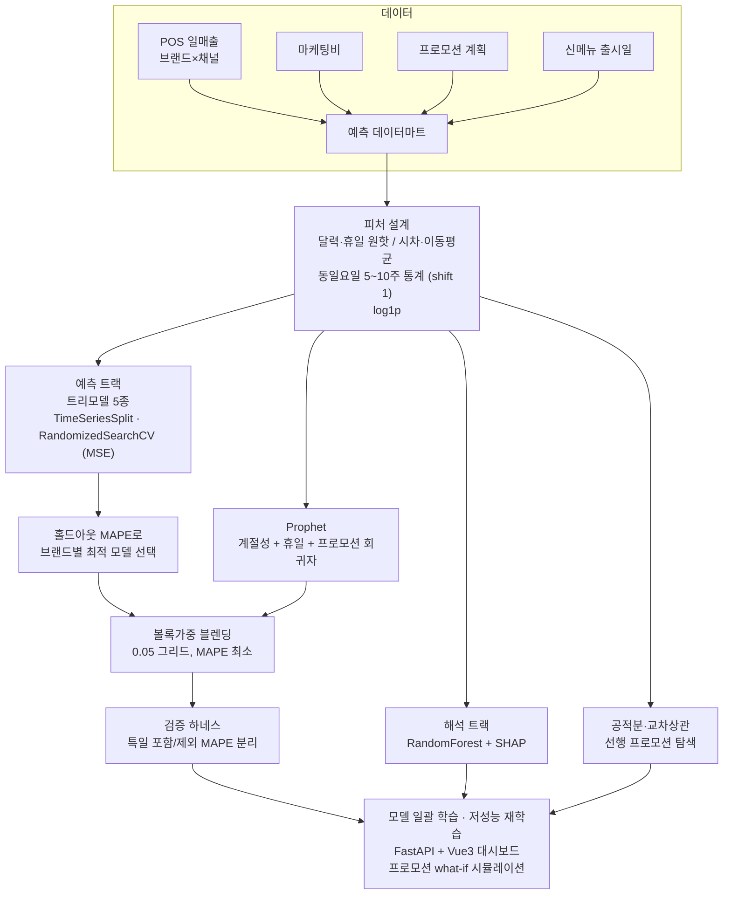

# 01 · 시계열 매출 예측 — 트리모델 후보선택 + Prophet 볼록가중 블렌딩

F&B 프랜차이즈의 **브랜드 × 배달채널 일매출**을 예측해 발주·인력 스케줄 기준을 만들고, 프로모션 시나리오별 매출 변화를 비기술 사용자가 직접 시뮬레이션할 수 있게 한 프로젝트입니다.

## 문제 설정

- 타깃: 브랜드별 일 총매출과 배달채널별 매출 (패널: `brand × channel × date`)
- 제약: 채널마다 프로모션이 따로 돌아가므로 채널 모델은 **자기 채널 프로모션만** 봐야 함
- 요구: 모델 학습·재학습이 자동으로 돌고, 현업이 프로모션을 바꿔 넣으면 결과가 바로 보여야 함

## 데이터 (종류만)

| 출처 | 내용 |
|---|---|
| POS DB | 브랜드·채널별 일매출 |
| 스프레드시트 | 마케팅 집행비 (브랜드·일) |
| 운영 DB | 채널별 프로모션 계획 (on/off, 할인폭) |
| 운영 캘린더 | 신메뉴 출시일 |
| 공휴일 캘린더 | 공휴일·주말·복날·명절 |

## 분석 프로세스



## 방법

1. **데이터마트** — 네 출처를 날짜 키로 병합. 마케팅비는 집행 +2일 효과 변수를 추가.
2. **피처** — 요일·월·주차, 휴일·명절 원핫, 전일·전주 동일요일 시차, 이동평균 7/14, 동일요일 5~10주 mean/min/max/var. 모든 롤링 통계는 `shift(1)` 뒤에 계산해 **타깃 누수를 차단**. 워밍업 구간 NaN 행 제거, 타깃은 `log1p`.
3. **두 트랙**
   - 해석: RandomForest(RandomizedSearchCV) + SHAP mean|value|로 매출 요인 순위
   - 예측: ExtraTrees / RandomForest / GradientBoosting / XGBoost / LightGBM를 `TimeSeriesSplit` + `RandomizedSearchCV`로 **MSE 기준 튜닝**, 홀드아웃 **MAPE 기준 선택** (튜닝 지표와 선택 지표를 분리)
4. **Prophet** — 연·주 계절성(multiplicative), 국가 공휴일, 프로모션·휴일·동일요일 통계를 `add_regressor`.
5. **블렌딩** — 브랜드별로 `w ∈ {0, 0.05, …, 1}` 그리드에서 MAPE 최소 볼록가중. 명절 같은 특일은 사후 보정계수.
6. **검증 하네스** — 특일 포함/제외 MAPE를 따로 산출해 "평소 정확도"와 "특일 정확도"를 분리 보고.
7. **보조 분석** — 매출 vs 프로모션 공적분·교차상관으로 선행 프로모션 탐색, 채널별 할인구간 효과 히트맵.
8. **운영** — 브랜드×채널 전 조합 모델 일괄 학습(설명력이 낮은 모델은 탐색 횟수를 늘려 즉시 재학습), 피처 카테고리를 UI에서 제외 선택, what-if 시뮬레이션, 95% 신뢰구간, LLM 자동 해설. Dash 프로토타입으로 검증한 뒤 FastAPI+Vue3로 재구축.

## 코드 발췌

```python
# 트리모델 후보선택 (TimeSeriesSplit CV, MSE 튜닝 → MAPE 선택)
from sklearn.model_selection import TimeSeriesSplit, RandomizedSearchCV
from sklearn.metrics import mean_absolute_percentage_error
import numpy as np

models = {'ExtraTrees': ExtraTreesRegressor(random_state=42, n_jobs=-1),
          'RandomForest': RandomForestRegressor(random_state=42, n_jobs=-1),
          'GradientBoosting': GradientBoostingRegressor(random_state=42),
          'XGBoost': XGBRegressor(random_state=42, n_jobs=-1, verbosity=0),
          'LightGBM': LGBMRegressor(random_state=42, n_jobs=-1, verbosity=-1)}
tscv = TimeSeriesSplit(n_splits=5)
best = None
for name, m in models.items():
    s = RandomizedSearchCV(m, param_grids[name], n_iter=15, cv=tscv,
                           scoring='neg_mean_squared_error', n_jobs=-1)
    s.fit(X_train, y_train_log)                       # target = log1p(sales)
    pred = np.maximum(np.expm1(s.best_estimator_.predict(X_test)), 0)
    mape = mean_absolute_percentage_error(y_test, pred) * 100
    if best is None or mape < best[0]:
        best = (mape, s.best_estimator_, name)

# Prophet + 볼록가중 블렌딩
from prophet import Prophet
mp = Prophet(yearly_seasonality=True, weekly_seasonality=True, daily_seasonality=False,
             seasonality_mode='multiplicative', changepoint_prior_scale=0.05)
mp.add_country_holidays(country_name='KR')
for feat in regressor_cols:                            # 프로모션 + 휴일 + 동일요일 통계
    mp.add_regressor(feat)
mp.fit(train_df)                                       # cols: ds / y / regressors
prophet_pred = np.maximum(mp.predict(future_df)['yhat'].values, 0)

best_w, best_mape = None, float('inf')
for w in np.arange(0, 1.01, 0.05):
    blended = w * prophet_pred + (1 - w) * tree_pred
    mape = mean_absolute_percentage_error(y_true, blended) * 100
    if mape < best_mape:
        best_mape, best_w = mape, (w, 1 - w)
```

```python
# 동일요일 통계 피처 — shift(1)로 누수 차단
def same_weekday_stats(df, col='sales', weeks=(5, 10)):
    out = df.copy()
    for w in weeks:
        g = out.groupby('weekday')[col]
        out[f'{col}_sw{w}_mean'] = g.transform(lambda s: s.shift(1).rolling(w, min_periods=2).mean())
        out[f'{col}_sw{w}_min']  = g.transform(lambda s: s.shift(1).rolling(w, min_periods=2).min())
        out[f'{col}_sw{w}_max']  = g.transform(lambda s: s.shift(1).rolling(w, min_periods=2).max())
    return out
```

## 검증과 한계

- 튜닝(MSE)과 선택(MAPE)의 지표를 분리한 이유: MSE는 큰 오차 날을 벌점 주고, MAPE는 매출이 작은 날의 상대 오차를 보므로 둘을 같이 봐야 발주 기준으로 쓸 수 있음.
- 특일(명절·연말)은 표본이 적어 별도 보정계수로 처리. 특일 제외 MAPE를 "평소 정확도"로 보고.
- 정확도 수치는 데이터 시점·브랜드마다 달라 이 저장소에는 싣지 않음.
