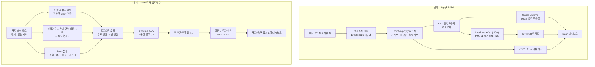

# 02 · 공간통계 (ESDA) — Moran's I · LISA · KDE, 순열검정과 K-민감도, 격자 입지점수

매장 위치·리뷰 데이터로 **업종의 공간 분포 패턴**(핫스팟·콜드스팟)을 통계적으로 판정하고, 250m 격자 단위로 **신규 출점 후보 상권의 적합도**를 점수화한 프로젝트입니다.

## 문제 설정

- 1단계: 시군구 단위로 "어디가 뭉쳐 있고 어디가 비어 있는가"를 우연이 아닌 패턴으로 판정
- 2단계: 타깃 업종이 아직 없는 격자 중 "잘되는 타깃 업종 상권"을 닮은 곳을 찾기
- 제약: 점포당 성과(매출)는 위치만으로 설명되지 않으므로 **스크리닝**이 목표이지 매출 예측이 아님

## 데이터 (종류만)

| 출처 | 내용 |
|---|---|
| 리뷰 플랫폼 수집 | 매장 포인트(위경도·업종), 리뷰 수 |
| 행정경계 | 시도·시군구·행정동 폴리곤 |
| 상권정보 격자 | 250m 격자별 외식 매장 수, 임대료, 공실률, 접근성 등 수십 개 속성 |
| 생활인구 | 격자별 시간대·연령·성별 유동 인구 |

## 분석 프로세스



## 방법

### 1단계 — 시군구 ESDA
1. Shapefile(cp949) → 공통 CRS(EPSG:4326). 매장 포인트를 폴리곤에 `sjoin(predicate='within')`으로 붙여 구역별 가게수·리뷰수·활력지수 집계.
2. `libpysal` **KNN 공간가중치**(행표준화). 인접(Queen) 대신 KNN을 쓴 이유는 섬·월경지가 이웃 없이 남지 않게 하기 위해서.
3. **Global Moran's I** — 999회 조건부 순열로 p_sim·z 산출.
4. **Local Moran's I (LISA)** — 사분면 + p_sim으로 HH/LL/LH/HL, p≥0.05는 NS.
5. **K-민감도** — K=3/5/8에서 클러스터 라벨이 바뀌는지 비교해 결론 안정성 확인.
6. **KDE** — 단순 밀도와 리뷰 가중 밀도를 비교, 업종별·광역권 확대.
7. Dash 앱: 업종 전체 + 브랜드 비교 3열, LISA 지도, Moran 산점도, 엑셀 다운로드. Moran/LISA 중복 계산을 없애 분석 시간을 절반으로 줄임.

### 2단계 — 격자 입지점수
1. 격자 속성에서 전체가 0인 컬럼을 제외한 분석 마트.
2. **proxy 검증** — 타깃 업종과 유사 업종의 점포·리뷰 상관을 Pearson·Spearman·**외식밀도 통제 편상관**으로 봄. 밀도를 통제하면 상관이 거의 0 → 유사 업종은 대리지표로 부적합.
3. **수요축** — 생활인구를 시간대·연령 *비중*으로 바꿔(번화도 제거) 타깃 리뷰와의 상관을 보고 "저녁 × 젊은층" 축을 정의. 표본이 큰 유사 업종에서 같은 신호가 재현되는지 확인.
4. **lever 분류** — 외식 매장 수처럼 "매장이 곧 리뷰를 만드는" 순환 변수는 경쟁축(분모)으로만, 접근성(지하철·상권 거리)은 유효 신호, 임대료·공실은 비용·리스크 축.
5. **모델** — 강도 상위 타깃 격자(양성) vs 타깃이 없는 격자(음성)로 LogisticRegression(`class_weight='balanced'`, C=0.1). 기여 ≈0인 변수를 빼 12→5변수로 단순화. 5-fold CV AUC와 **공간 블록 CV**를 함께 보고 이웃 누수에 의한 낙관을 배제.
6. 전 격자 적합도를 z→T(평균 50, SD 10)로 변환, 미진입 격자 상위를 추천 목록·SHP로 출력.
7. 결과 노트북 ↔ 프로덕션 CSV 정합성 검토, 대시보드 노출 갭 분석.

## 코드 발췌

```python
import numpy as np
from libpysal import weights
from libpysal.weights.spatial_lag import lag_spatial
from esda.moran import Moran, Moran_Local

def run_esda(gdf, column, k=5, permutations=999):
    w = weights.KNN.from_dataframe(gdf, k=k)
    w.transform = 'R'                                   # 행표준화
    y = gdf[column].values

    moran = Moran(y, w, permutations=permutations)      # Global
    global_res = dict(I=moran.I, p=moran.p_sim, z=moran.z_sim,
                      significant=moran.p_sim < 0.05)

    lisa = Moran_Local(y, w, permutations=permutations) # Local
    def classify(q, p):
        if p >= 0.05: return 'NS'
        return {1: 'HH', 2: 'LH', 3: 'LL', 4: 'HL'}.get(q, 'NS')
    out = gdf.copy()
    out['lisa_I'] = lisa.Is
    out['lisa_p'] = lisa.p_sim
    out['cluster'] = [classify(q, p) for q, p in zip(lisa.q, lisa.p_sim)]

    y_std = (y - y.mean()) / y.std()                    # Moran 산점도용
    out['lag_std'] = lag_spatial(w, y_std)
    return global_res, out

# K-민감도: 라벨 안정성
labels = {k: run_esda(gdf, 'vitality', k=k)[1]['cluster'] for k in (3, 5, 8)}
stable = (labels[3] == labels[5]) & (labels[5] == labels[8])
```

```python
# 격자 입지점수 — 공간 블록 CV (이웃 누수 방지)
from sklearn.linear_model import LogisticRegression
from sklearn.model_selection import GroupKFold, cross_val_score

X = grid[features].values
y = (grid['target_strength_rank'] <= TOP_N).astype(int)        # 강도 상위 = 1, 빈 상권 = 0
blocks = (grid['gx'] // BLOCK) * 1000 + (grid['gy'] // BLOCK)  # 격자 좌표 → 블록 ID

clf = LogisticRegression(C=0.1, class_weight='balanced', max_iter=2000)
auc_random = cross_val_score(clf, X, y, cv=5, scoring='roc_auc').mean()
auc_spatial = cross_val_score(clf, X, y, cv=GroupKFold(5), groups=blocks, scoring='roc_auc').mean()

clf.fit(X, y)
z = clf.decision_function(X)
grid['fit_T'] = 50 + 10 * (z - z.mean()) / z.std()             # z → T 점수
recommend = grid[(grid['target_stores'] == 0)].nlargest(40, 'fit_T')
```

## 검증과 한계

- 순열검정 999회로 Moran's I의 p값을 분포 가정 없이 구함. K를 바꿔도 핵심 클러스터가 유지되는지 확인.
- 입지점수의 주력 신호는 번화도이므로 "먹자골목·번화 상권"을 재발견하는 성격이 강함. 점포당 성과와의 상관은 낮아 **후보 좁히기까지가 정직한 역할**, 최종은 현장 답사.
- MAUP(공간 단위 변경에 따른 상관 변화)를 동 단위 결과 해석에서 명시.
