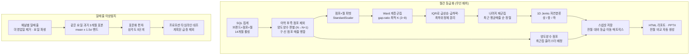

# 03 · 점포 등급화 — Ward HAC 최적 K + Jenks 자연분류, 요일조건부 이상탐지

수백 개 점포의 월별 매출 패턴을 **사람 손 없이 매월** 상/중/하로 등급화하고 급상승·급하락·정체 점포를 자동 선별하는 무인 배치. 별도로 일매출 **이상치 탐지**를 요일 효과를 통제해 수행.

## 문제 설정

- 라벨이 없는 점포×월 매출 행렬에서 "비슷한 궤적"끼리 묶고, 묶음을 **등급으로 해석**할 수 있어야 함
- 점포가 양도양수되면 번호가 바뀌어 이력이 끊김 → 자동 판별·병합 필요
- 매월 돌면서 전월과 비교해 "등급이 옮겨간 점포"를 보여줘야 함
- 이상탐지: F&B 매출은 요일 효과가 커서 전체 평균 기준 밴드는 주말을 전부 이상으로 잡음

## 데이터 (종류만)

- (브랜드, 점포, 월) 물류매출·POS매출, 14개월 롤링 — 사내 DB에서 SQL 집계
- 점포 마스터(점포명·번호), 프로모션 타임라인
- 이상탐지: (일, 채널) 매출

## 분석 프로세스



## 방법

1. **양도양수 판별** — 같은 기본 점포명에서 번호가 N→N+1로 바뀌면 양도양수로 보고, 구·신 점포 매출을 하나로 병합(겹치는 월은 합산). 양도 시점은 신 점포의 첫 매출 발생월.
2. **최적 K** — Ward linkage의 병합거리 프로파일에서 `gap_ratio = (d_k − d_{k+1}) / d_{k+1}`이 최대인 K를 3~8 범위에서 자동 선택. 덴드로그램을 사람이 보지 않아도 되게 하기 위함.
3. **이상치 사전 분리** — 최근 구간 변화율의 IQR로 급상승·급하락·최하위정체 점포를 먼저 떼어 놓고 나머지를 재군집. 극단 점포가 군집 중심을 끌고 가는 것을 막음.
4. **등급 해석** — 클러스터를 최근 평균매출로 정렬한 뒤 **1차원 Jenks 자연분류**로 상/중/하 경계를 급내 제곱합 최소로 결정.
5. **재배정** — 양도양수 점포는 병합된 패턴과 유클리드 거리가 가장 가까운 클러스터에 배정.
6. **전월 비교** — 스냅샷을 저장하고 이전 등급 × 현재 등급 매트릭스(신규 진입·이탈 포함)를 산출.
7. **이상탐지** — 대상일 기준 과거 3개월의 **같은 요일** 표본(n≥3)으로 mean±1.5σ 밴드, `|actual − mean| / std`로 심각도 5단계. 프로모션 기간의 급증은 "계획된 것"으로 제외.

## 코드 발췌

```python
from sklearn.preprocessing import StandardScaler
from scipy.cluster.hierarchy import linkage, fcluster
import numpy as np, pandas as pd

def find_optimal_k_hac(pivot_df, min_k=3, max_k=8):
    Z = linkage(StandardScaler().fit_transform(pivot_df), method='ward')
    d = Z[:, 2]; n = len(d); cand = []
    for k in range(min_k, min(max_k + 1, n + 1)):
        idx = n - (k - 1)
        cur, prev = d[idx - 1], (d[idx - 2] if idx >= 2 else 0)
        cand.append({'k': k, 'gap_ratio': (cur - prev) / prev if prev > 0 else float('inf')})
    df = pd.DataFrame(cand)
    return Z, int(df.loc[df['gap_ratio'].idxmax(), 'k'])

def jenks_3(values):                      # 1-D Jenks, 급내 제곱합 최소 2개 절단점
    v = np.sort(values)[::-1]; n = len(v)
    c1, c2 = np.cumsum(v), np.cumsum(v ** 2)
    def ssd(a, b):
        if b <= a: return 0.0
        s1 = c1[b-1] - (c1[a-1] if a else 0); s2 = c2[b-1] - (c2[a-1] if a else 0)
        return s2 - s1 ** 2 / (b - a)
    best, cut = float('inf'), (n // 3, 2 * n // 3)
    for i in range(1, n - 1):
        g1 = ssd(0, i)
        if g1 >= best: continue
        for j in range(i + 1, n):
            t = g1 + ssd(i, j) + ssd(j, n)
            if t < best: best, cut = t, (i, j)
    return cut
```

```python
WEEKDAY_KO = {0:'월',1:'화',2:'수',3:'목',4:'금',5:'토',6:'일'}

def detect_anomalies(df, rolling_months=3, sigma=1.5):
    df['요일'] = df['weekday'].map(WEEKDAY_KO)
    g = df.groupby(['channel', 'oper_date', '요일'])['sales_amount'].sum().reset_index()
    results = []
    for ch, cdf in g.groupby('channel'):
        cdf = cdf.sort_values('oper_date')
        for _, row in cdf.iterrows():
            d, wd, actual = row['oper_date'], row['요일'], row['sales_amount']
            lookback = d - pd.DateOffset(months=rolling_months)
            hist = cdf[(cdf['요일'] == wd) & (cdf['oper_date'] >= lookback) &
                       (cdf['oper_date'] < d)]['sales_amount']        # 같은 요일, 대상일 제외
            if len(hist) < 3 or hist.std() in (0, np.nan): continue
            mean, std = hist.mean(), hist.std()
            dev = abs(actual - mean) / std
            sev = ('정상' if dev <= sigma else '낮음' if dev < 2.0 else
                   '보통' if dev < 2.5 else '높음' if dev < 3.0 else '심각')
            results.append(dict(date=d, channel=ch, deviation=dev, severity=sev))
    return pd.DataFrame(results)
```

## 검증과 한계

- 등급 경계는 매월 다시 계산되므로 "등급 이동"에는 점포 변화와 경계 이동이 섞임 → 리포트에 전월 매트릭스와 함께 브랜드 전체 평균 변화를 같이 표시.
- 양도양수 판별은 점포명 규칙에 의존하므로 원천 데이터와 차이가 있을 수 있음을 리포트에 명시.
- 점포 수·매출액 등 실측치는 싣지 않음.
