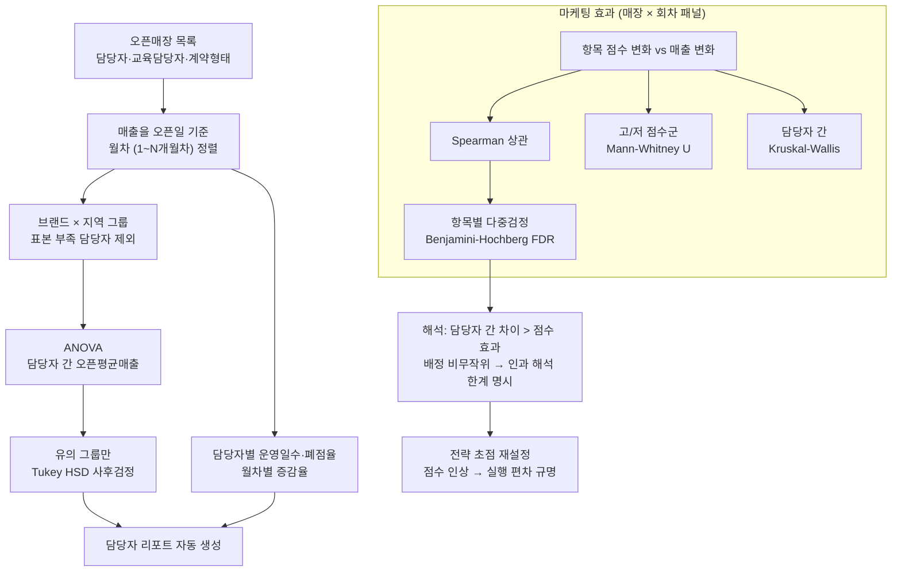

# 04 · 효과 검증 — ANOVA/Tukey, 비모수 검정, Benjamini-Hochberg FDR

신규 오픈 매장에서 **담당자에 따라 매출이 다른지**, **오픈 마케팅 항목 점수가 매출로 이어지는지**를 통계적으로 검증해 운영팀의 전략 초점을 바꾼 프로젝트입니다.

## 문제 설정

- 가설 1: 오픈 담당자(또는 교육 담당자·창업 담당자)에 따라 오픈 후 평균매출이 다르다
- 가설 2: 마케팅 항목 점수가 높을수록 매출이 오른다
- 제약: 담당자-매장 배정은 무작위가 아님 → **인과 해석은 불가**, 연관성 검정으로 범위를 한정
- 항목이 수십 개라 항목별 검정을 반복하면 위양성이 쌓임 → 다중비교 보정 필수

## 데이터 (종류만)

- 오픈매장 패널: 브랜드·지역·담당자·계약형태·오픈일·월차별 매출
- 마케팅 점검표: 매장 × 회차(오픈 → 2개월 → 4개월) × 항목 점수

## 분석 프로세스



## 방법

1. **패널 구성** — 오픈일을 0으로 두고 월차별 매출을 정렬. 표본이 너무 적은 담당자는 제외 규칙으로 뺌.
2. **담당자 효과** — 브랜드×지역 그룹 안에서 일원분산분석. 유의한 그룹만 Tukey HSD로 어느 담당자 쌍이 다른지 확인. 보조 지표로 담당자별 운영일수·폐점율·월차별 증감율.
3. **마케팅 효과** — 점수 변화와 매출 변화의 Spearman 상관(비선형·이상치에 강건), 고/저 점수군 Mann-Whitney U, 담당자 간 Kruskal-Wallis. 항목별 p값은 **Benjamini-Hochberg FDR**로 보정(adj < 0.1). 보정 함수는 입력 순서를 보존하고 단조성을 강제하도록 직접 구현.
4. **해석** — 담당자 간 차이가 점수-매출 상관보다 뚜렷하게 관측됨. 배정이 비무작위이므로 "담당자가 원인"이라고 쓰지 않고, 초점을 "항목 점수 인상"에서 "담당자별 실행 편차 규명"으로 옮기자고 제안.
5. **리포트** — 오픈/창업/통합 HTML 리포트를 스크립트로 자동 생성.

## 코드 발췌

```python
import numpy as np
from scipy.stats import f_oneway, spearmanr, mannwhitneyu, kruskal
from statsmodels.stats.multicomp import pairwise_tukeyhsd

def fdr_bh(pvals):
    """Benjamini-Hochberg 보정 p (입력 순서 보존, 단조성 강제)."""
    p = np.asarray(pvals, float); n = len(p)
    order = np.argsort(p)
    adj = np.minimum(1.0, p[order] * n / np.arange(1, n + 1))
    for i in range(n - 2, -1, -1):
        adj[i] = min(adj[i], adj[i + 1])
    out = np.empty(n); out[order] = adj
    return out

# 담당자 효과: 그룹별 ANOVA → 유의 그룹만 Tukey
for (brand, region), g in panel.groupby(['brand', 'region']):
    groups = [x['open_avg_sales'].values for _, x in g.groupby('manager') if len(x) >= MIN_N]
    if len(groups) < 2: continue
    F, p = f_oneway(*groups)
    if p < 0.05:
        tk = pairwise_tukeyhsd(g['open_avg_sales'], g['manager'])

# 마케팅 효과
rho, p_rho = spearmanr(chg['score_delta'], chg['sales_delta'])
_, p_mwu  = mannwhitneyu(high_grp, low_grp, alternative='two-sided')
H, p_kw   = kruskal(*[x for x in manager_groups if len(x) >= 3])
item_p    = [spearmanr(chg[c], chg['sales_delta'])[1] for c in item_cols]
keep      = [c for c, q in zip(item_cols, fdr_bh(item_p)) if q < 0.1]
```

## 검증과 한계

- 비모수 검정을 택한 이유: 매장 매출 분포가 치우쳐 있고 그룹 표본이 작음.
- FDR 임계 0.1은 탐색 목적(후속 확인 대상 선별)으로 설정.
- 교란(입지·브랜드·시기)을 통제하지 않았으므로 결과는 "연관"이며, 보고서에 그 한계를 명시했음.
