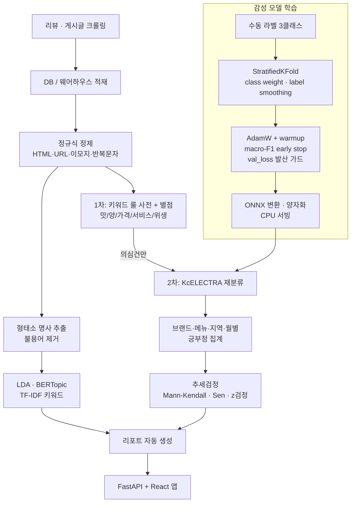

# 05 · 한국어 리뷰 감성·토픽 분석 — 룰 + KcELECTRA 하이브리드, ONNX CPU 서빙

배달앱·지도 리뷰와 커뮤니티 글을 자동 수집해 **감성·토픽·키워드**를 뽑고, 브랜드·메뉴·지역·월별 리포트를 자동 생성하는 VOC 분석 체계입니다.

## 문제 설정

- 수십만 건 누적 리뷰를 사람이 읽지 않고 메뉴·서비스 개선 우선순위를 뽑아야 함
- 라벨 데이터는 적고 클래스가 불균형(긍정이 압도적)
- 추론은 GPU 없는 사내 서버에서 돌아야 함 → 트랜스포머를 **모든 리뷰에** 돌릴 수는 없음
- "메뉴 맛이 변했다"는 신호를 리뷰 추세에서 통계적으로 잡아야 함

## 데이터 (종류만)

- 배달앱·지도 리뷰(작성일·본문·별점·메뉴·지역), 커뮤니티 게시글
- 감성 라벨셋: 수동 라벨 3클래스(긍/부/중)

## 분석 프로세스



## 방법

1. **하이브리드 2단계** — 카테고리 키워드 사전 + 별점으로 1차 분류하고, 룰이 애매한 '의심건'만 트랜스포머로 재분류. 추론 비용을 줄이면서 정확도는 유지.
2. **파인튜닝** — `beomi/KcELECTRA-base` 3클래스. StratifiedKFold(5~7), `compute_class_weight('balanced')` + label smoothing 0.1, AdamW + linear warmup(10%), grad clip 1.0. **macro-F1** 기준 early stop과, val_loss가 최저 대비 1.5배를 넘으면 중단하는 과적합 가드.
3. **서빙** — ONNX 변환(opset 14, dynamic axes) 후 동적 양자화, onnxruntime CPU 추론.
4. **토픽·키워드** — kiwipiepy 명사(NNG/NNP)·길이≥2·도메인 불용어 제거 → LDA(pyLDAvis), BERTopic(SentenceTransformer + UMAP + HDBSCAN). 키워드는 TF-IDF(1,2-gram).
5. **추세검정** — 메뉴별 월간 긍정률에 Mann-Kendall(비모수 추세), Sen's slope(속도), 정점기 vs 최근 2-비율 z검정(효과크기 Cohen's h). 대조 메뉴와 하락 속도 차이는 OLS 상호작용으로 검정.
6. **리포트** — 분기별 브랜드 리포트, 메뉴 심층 리포트(레시피 변경 전후), 신메뉴 리포트를 템플릿으로 자동 생성.

## 코드 발췌

```python
from sklearn.model_selection import StratifiedKFold
from sklearn.utils.class_weight import compute_class_weight
from sklearn.metrics import f1_score
from transformers import AutoTokenizer, AutoModelForSequenceClassification, get_linear_schedule_with_warmup
import numpy as np, torch

MODEL_NAME = "beomi/KcELECTRA-base"
labels = df["label_manual"].map({"긍정": 0, "부정": 1, "중립": 2}).values
cw = compute_class_weight("balanced", classes=np.array([0, 1, 2]), y=labels)
criterion = torch.nn.CrossEntropyLoss(weight=torch.tensor(cw, dtype=torch.float32).to(DEVICE),
                                      label_smoothing=0.1)
tokenizer = AutoTokenizer.from_pretrained(MODEL_NAME)
skf = StratifiedKFold(n_splits=N_FOLDS, shuffle=True, random_state=42)

for fold, (tr, va) in enumerate(skf.split(texts, labels), 1):
    model = AutoModelForSequenceClassification.from_pretrained(
        MODEL_NAME, num_labels=3, hidden_dropout_prob=0.2, attention_probs_dropout_prob=0.2).to(DEVICE)
    opt = torch.optim.AdamW(model.parameters(), lr=2e-5, weight_decay=0.05)
    total = len(train_dl) * EPOCHS
    sch = get_linear_schedule_with_warmup(opt, int(total * 0.1), total)
    best_f1, best_vloss, no_improve = 0.0, float("inf"), 0
    for epoch in range(1, EPOCHS + 1):
        model.train()
        for b in train_dl:
            opt.zero_grad()
            out = model(input_ids=b["input_ids"].to(DEVICE), attention_mask=b["attention_mask"].to(DEVICE))
            loss = criterion(out.logits, b["label"].to(DEVICE)); loss.backward()
            torch.nn.utils.clip_grad_norm_(model.parameters(), 1.0)
            opt.step(); sch.step()
        vloss, f1 = evaluate(model, val_dl)            # macro-F1
        best_vloss = min(best_vloss, vloss)
        if f1 > best_f1: best_f1, no_improve = f1, 0; model.save_pretrained(fold_path)
        else: no_improve += 1
        if vloss / best_vloss > 1.5: break             # 과적합(발산) 가드
        if no_improve >= PATIENCE: break               # early stop
```

```python
# ONNX 변환 + CPU 추론
import onnxruntime as ort
torch.onnx.export(model.eval(), (enc["input_ids"], enc["attention_mask"]), onnx_path,
                  input_names=["input_ids", "attention_mask"], output_names=["logits"],
                  dynamic_axes={"input_ids": {0: "batch", 1: "seq"},
                                "attention_mask": {0: "batch", 1: "seq"}, "logits": {0: "batch"}},
                  opset_version=14, do_constant_folding=True)
sess = ort.InferenceSession(onnx_path, providers=["CPUExecutionProvider"])
logits = sess.run(None, {"input_ids": ids.astype(np.int64), "attention_mask": mask.astype(np.int64)})[0]
```

```python
# 메뉴 긍정률 추세검정
import pymannkendall as mk
from statsmodels.stats.proportion import proportions_ztest
res = mk.original_test(monthly_pos_rate_after_peak)        # tau, p, Sen's slope
z, p = proportions_ztest([pos_peak, pos_recent], [n_peak, n_recent])
h = 2 * (np.arcsin(np.sqrt(pos_peak / n_peak)) - np.arcsin(np.sqrt(pos_recent / n_recent)))  # Cohen's h
```

## 검증과 한계

- 룰 1차 분류의 재현율을 모델 2차가 보완하므로, 룰 사전은 FN/FP 예외 패턴을 계속 추가하는 운영 자산.
- 표본이 수십 건인 초기 월은 추세검정에서 제외(참고용).
- 리뷰 원문·브랜드별 지표·모델 성능 실측치는 싣지 않음. 코드 레시피는 별도 비공개 저장소(data-cookbook)에 정리.
