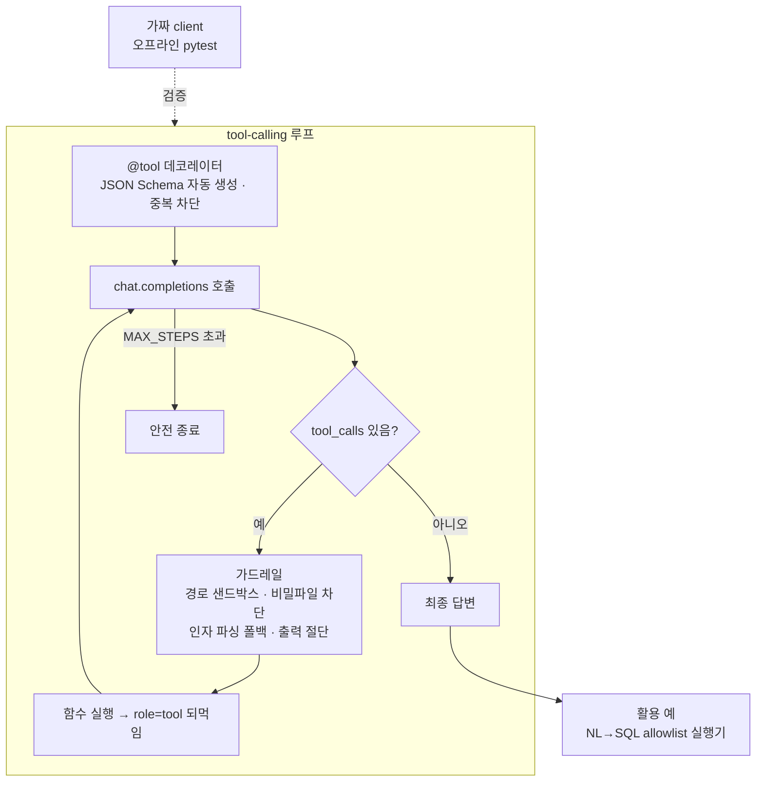

# 06 · Gen-AI 도구사용 에이전트 — 프레임워크 없는 tool-calling 루프와 가드레일

LLM이 로컬 파일·DB를 **직접 읽고 답하되**, 위험한 경로 접근이나 무한 호출이 생기지 않도록 가드레일을 코드로 강제한 에이전트 템플릿입니다.

## 문제 설정

- "모델은 판단만, 실행은 코드가" — 도구 권한을 LLM이 아니라 코드가 결정해야 함
- 프레임워크 없이 루프를 직접 써서 동작을 전부 설명할 수 있어야 함
- API 키 없이도 테스트가 돌아야 함(오프라인 TDD)

## 분석 프로세스



## 방법

1. **도구 등록** — `@tool(name, description, parameters)` 데코레이터가 인자로 받은 파라미터 정의를 JSON Schema로 조립해 레지스트리에 넣고, 같은 이름이 또 오면 예외(조용한 덮어쓰기 방지).
2. **루프** — 응답에 `tool_calls`가 있으면 **모든** 호출에 반드시 `role="tool"`로 답을 붙여 되먹임. 없어지면 최종 답변. `MAX_STEPS`를 넘기면 안전 종료 메시지.
3. **가드레일 6종** — `realpath` 기반 허용 루트 검사, `.env/.pem/.key/id_rsa` 차단, 도구 인자 `json.loads` 실패 시 빈 dict, 도구 예외를 문자열로 흡수, 출력 길이 절단, 빈 `tools` 배열은 미전송(API 400 방지).
4. **테스트** — 가짜 client가 정해진 tool_calls 시퀀스를 돌려주게 해서 네트워크 없이 pytest.
5. **활용** — 같은 "코드가 권한을 정한다" 원칙으로 만든 자연어 → SQL 실행기: allowlist로 SELECT/WITH/EXPLAIN만 허용하고 금지 키워드를 차단. 다른 프로젝트의 LLM 호출은 모델 등급을 3단계로 나눠 비용을 관리.

## 코드 발췌

```python
_REGISTRY = []
def tool(name, description, parameters=None, required=None):
    if any(s["function"]["name"] == name for s, _ in _REGISTRY):
        raise ValueError(f"중복 도구 이름: {name!r}")
    params = {"type": "object", "properties": parameters or {}}
    if required: params["required"] = required
    schema = {"type": "function", "function": {"name": name, "description": description, "parameters": params}}
    def deco(fn):
        _REGISTRY.append((schema, fn)); return fn
    return deco

def agent_reply(messages, client, *, model, tools, tool_funcs, max_steps=8):
    for _ in range(max_steps):
        kwargs = {"model": model, "messages": messages}
        if tools: kwargs["tools"] = tools                       # 빈 배열이면 미전송
        msg = client.chat.completions.create(**kwargs).choices[0].message
        assistant = {"role": "assistant", "content": msg.content or ""}
        if msg.tool_calls:
            assistant["tool_calls"] = [{"id": tc.id, "type": "function",
                "function": {"name": tc.function.name, "arguments": tc.function.arguments or "{}"}}
                for tc in msg.tool_calls]
        messages.append(assistant)
        if not msg.tool_calls:
            return msg.content or ""
        for tc in msg.tool_calls:                               # 모든 tool_call에 반드시 응답
            try: args = json.loads(tc.function.arguments or "{}")
            except json.JSONDecodeError: args = {}
            result = _run_tool(tc.function.name, args, tool_funcs)   # 예외 → 문자열
            if len(result) > MAX_TOOL_OUTPUT_CHARS:
                result = result[:MAX_TOOL_OUTPUT_CHARS] + "\n...[잘림]"
            messages.append({"role": "tool", "tool_call_id": tc.id, "content": result})
    return "⚠️ 도구 호출이 너무 많아 중단했습니다."

def _safe_path(path, allowed_root):
    full = os.path.realpath(path); root = os.path.realpath(allowed_root)
    if full != root and not full.startswith(root + os.sep): return None
    base = os.path.basename(full).lower()
    if base in _DENY_NAMES or base.endswith(_DENY_SUFFIXES): return None
    return full
```

```python
# 오프라인 테스트용 가짜 client
class FakeClient:
    def __init__(self, scripted): self.scripted = list(scripted)   # [tool_calls | None, ...]
    class chat:
        class completions:
            @staticmethod
            def create(**kw): ...
```

## 검증과 한계

- 가드레일은 "모델이 시도해도 코드가 거부"하는 구조이므로 프롬프트 우회에 영향받지 않음.
- 사내 서비스에 붙인 단계가 아니라 재사용 템플릿이며, 개발 과정의 다중 에이전트 코드 리뷰는 동료가 만든 작업 환경을 이용한 것.
- 전체 템플릿 코드는 별도 저장소(gemma4-agent-template)에 있음.
