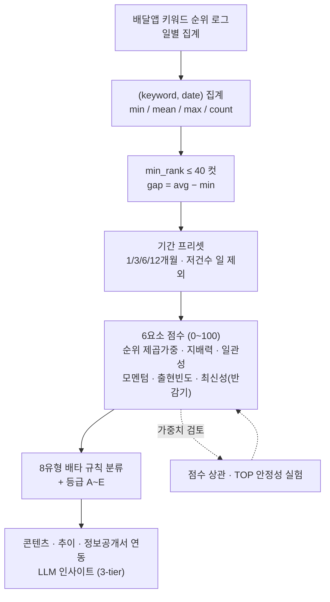
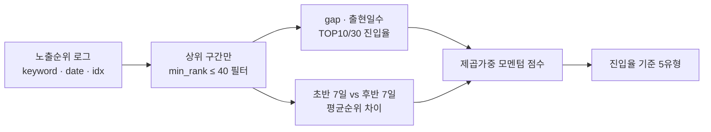
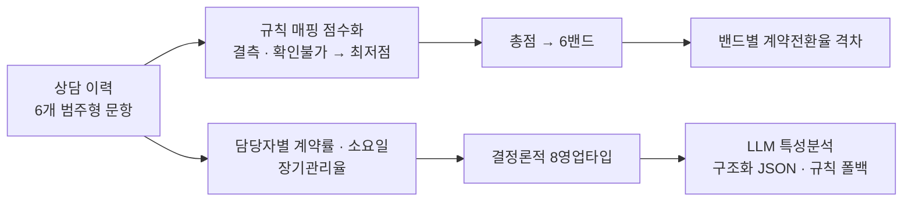
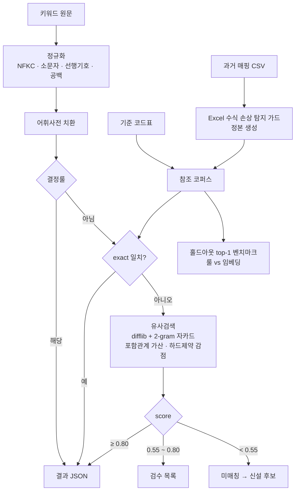

# 07 · 규칙 기반 스코어링 — 키워드 트렌드 · 노출순위 · 상담 점수화 · 매핑코드 자동 부여

학습 데이터가 없거나 "모른다"를 말해야 하는 문제에 **설명 가능한 규칙 점수**를 설계한 네 가지 사례입니다. 공통점은 파라미터를 코드 밖(설정 파일·기준표)으로 빼고, 분류를 배타 규칙으로 고정해 결과를 재현·검수할 수 있게 한 것입니다.

| 사례 | 입력 | 출력 |
|---|---|---|
| A. 키워드 트렌드 | 멀티채널 키워드 일별 순위 | 0~100 복합점수 + 8유형 |
| B. 노출순위 스코어링 설계(A의 전신) | 배달앱 검색 노출순위 로그 | 순위²×지속성 점수 + 6분류 |
| C. 상담 점수화 | 창업 상담 6문항 | 총점·밴드 → 계약전환율, 8영업타입 |
| D. 매핑코드 부여 | 주문 옵션·메뉴명 키워드 | 코드 + 신뢰도 + 검수 목록 |

## A. 키워드 트렌드 — 6요소 복합점수 + 8유형



- 순위는 선형이 아니라 **제곱 가중**(1위와 10위의 차이를 크게). 지배력은 TOP10 진입율과 평균순위 역수의 결합, 일관성은 저출현 키워드에 페널티, 최신성은 반감기 14일.
- 설계 단계(주간 모델)에서 비교 기간을 2~6주로 실험하고 점수 간 상관을 검토해 중복 요소(상위권↔안정성)를 찾아냄 → 운영에서는 지배력 요소로 재설계하고 기간은 월 단위 프리셋으로 전환. TOP 키워드는 가중치를 바꿔도 안정적임을 확인.
- 순위 입력은 배달앱 1채널이고, 유튜브·뉴스·블로그·공정위 정보공개서는 키워드를 고른 뒤 보는 연동 콘텐츠.

```python
w = COMPOSITE_WEIGHTS                         # scoring.json에서 주입
rank_score        = ((36 - df['best_rank']) ** 2 / 35 ** 2 * 100).clip(0, 100)
dominance_score   = (df['top10_rate'] * 60 + (1 / df['avg_rank']).clip(0, 1) * 40).clip(0, 100)
consistency_score = (1 - df['gap_std'] / max_gap_std) * 100 * (df['appearance_days'] / w['min_consistency_days']).clip(0, 1)
momentum_score    = (df['rank_change'].clip(-20, 20) / 40 * 100 + 50).clip(0, 100)
frequency_score   = (df['appearance_days'] / df['total_days'] * 100).clip(0, 100)
recency_score     = (100 * 0.5 ** (df['days_since_last'] / w['recency_half_life'])).clip(0, 100)
df['composite']   = (rank_score*w['rank'] + dominance_score*w['dominance'] + consistency_score*w['consistency']
                     + momentum_score*w['momentum'] + frequency_score*w['frequency'] + recency_score*w['recency']).round().astype(int)

def classify_keyword(r, c):                   # 우선순위 순 배타 규칙
    if r['is_new']:
        return '신규급상승' if r['best_rank'] <= c['신규급상승']['최고순위'] and r['top30_days'] >= c['신규급상승']['TOP30_진입일'] else '일반'
    if r['best_rank'] <= c['인기급상승']['최고순위'] and r['rank_change'] >= c['인기급상승']['순위상승']: return '인기급상승'
    if r['top10_rate'] >= c['TOP고정']['TOP10_진입율'] and r['appearance_days'] >= c['TOP고정']['최소_출현일수']: return 'TOP고정'
    if r['top10_rate'] >= c['TOP진입']['TOP10_진입율']: return 'TOP진입'
    if r['rank_change'] <= -c['주의']['순위하락']: return '주의'
    if r['top30_rate'] >= c['잠재상승']['TOP30_진입율'] and r['rank_change'] > 0: return '잠재상승'
    if r['top30_rate'] < c['일반']['TOP30_진입율']: return '일반'
    return '안정유지'
```

## B. 노출순위 스코어링 설계 단계 — 내부 피처 없이 관측 순위만으로 (A의 전신, v7)



- 플랫폼 내부 피처를 볼 수 없으므로 **휴리스틱(비-ML)**. 진입'율'을 기준으로 해 기간 길이가 달라도 분류가 일관되게. 이 단계의 점수는 순위 제곱가중 × TOP30 진입일(지속성)이며, 모멘텀·지배력은 이후 실험을 거쳐 A의 운영 점수에 들어감.
- 분류는 6가지(신규급상승·인기급상승·TOP고정·TOP진입·하락세·일반). 아래 발췌는 그중 5가지 규칙.

```python
daily = (df.groupby(["keyword", "date"]).agg(min_rank=("idx", "min"), avg_rank=("idx", "mean")).reset_index())
daily = daily[daily["min_rank"] <= RANK_FILTER]
W = 7; early, late = dates[:W], dates[-W:]
rows = []
for kw, g in daily.groupby("keyword"):
    best, days = int(g["min_rank"].min()), len(g)
    top30 = int((g["min_rank"] <= 30).sum()); hit10 = (g["min_rank"] <= 10).sum() / days
    e, l = g[g.date.isin(early)], g[g.date.isin(late)]
    delta = int(round(e["min_rank"].mean() - l["min_rank"].mean())) if len(e) and len(l) else 0
    score = int(((36 - best) ** 2) * top30 / 100) if best <= 35 else 0
    rows.append(dict(keyword=kw, best=best, days=days, hit10=hit10, top30=top30, delta=delta, score=score))

def classify(r):
    if r.best <= 20 and r.delta >= 10 and r.top30 >= 3: return "인기급상승"
    if r.delta <= -10:                                  return "하락세"
    if r.hit10 >= 0.89 and r.days >= 7:                 return "TOP고정"
    if r.hit10 >= 0.55 and r.days >= 7:                 return "TOP진입"
    return "일반"
```

## C. 상담 점수화 — 6문항 가중 점수 → 계약전환율



- 가중치는 현업(영업팀) 협의로 부여. 학습형 모델이 아니라 **규칙 점수 + 통계 집계**이며 보고서에 그렇게 명시. 영업타입은 8개 + 기본값 1개의 결정론적 규칙.
- LLM은 담당자 특성 요약(강점/약점/개선안)을 단일 프롬프트로 JSON으로 받고, 실패 시 규칙 텍스트로 폴백(에이전트 아님).

```python
SCORE_CRITERIA = {"capital": {"lv4": 20, "lv3": 17, "lv2": 14, "lv1": 11},
                  "contract": {"owns": 10, "new": 8, "switch": 6},
                  "timing": {"immediate": 20, "within_3m": 18, "after_3m": 16},
                  "operation": {"couple_family": 10, "solo": 8, "staff_invest": 6},
                  "experience": {"food_and_biz": 10, "either": 8, "none": 6},
                  "job": {"self_emp": 10, "prep": 8, "employee": 6}}
MIN_SCORE = {"capital": 8, "contract": 4, "timing": 14, "operation": 4, "experience": 4, "job": 4}

def score_row(row):
    total = 0
    for crit in SCORE_CRITERIA:
        val = str(row.get(crit, "")).strip()
        total += MIN_SCORE[crit] if (val in ("", "nan") or "확인불가" in val) else SCORE_CRITERIA[crit].get(val, MIN_SCORE[crit])
    return total

def to_band(score):
    for lo, label in [(70, "70-80"), (60, "60-69"), (50, "50-59"), (40, "40-49"), (30, "30-39"), (0, "0-29")]:
        if score >= lo: return label
```

## D. 매핑코드 자동 부여 — 다단계 매칭, "모른다"를 말하는 규칙



- 참조 CSV가 Excel에서 `-양념` → `=-양념` 수식으로 해석돼 일부가 손상된 사실을 규명하고, 손상본이 들어오면 멈추는 가드를 둠.
- 코드별 8:2 홀드아웃에서 규칙 매칭이 임베딩 모델(한국어 문장 임베딩)보다 top-1이 약간 높았고(차이는 1%p 수준, 테스트가 코퍼스와 같은 분포라 문자열 방식에 유리한 상대비교), 무엇보다 임베딩은 코드가 없는 항목에도 높은 점수로 오답을 내 "모른다"를 말하지 못함. 규칙은 score 임계로 미매칭을 분리. 구버전 규칙 대비 확정 물량 67% → 98.5%, 사람이 볼 물량 0.8%.
- 검수 결과는 세 갈래(과거 매핑 추가 / 어휘사전 / 코드표 신설)로만 반영. 한 번 들어간 오답은 다음 회차에 exact로 굳으므로 확신 없으면 넣지 않음.

```python
import unicodedata, difflib, re
def normalize(s):
    s = unicodedata.normalize("NFKC", s).lower()
    s = re.sub(r"^[-+#:*]+", "", s)
    return re.sub(r"\s+", "", s)

def bigrams(s): return {s[i:i+2] for i in range(len(s) - 1)} or {s}
def similarity(a, b):
    j = len(bigrams(a) & bigrams(b)) / len(bigrams(a) | bigrams(b))
    return (difflib.SequenceMatcher(None, a, b).ratio() + j) / 2       # 단일 0~1 척도

def match(keyword, corpus, lexicon, hard_constraints):
    q = normalize(keyword)
    for src, dst in lexicon.items(): q = q.replace(src, dst)
    if q in corpus: return corpus[q], 1.0, "exact"
    best_code, best = None, 0.0
    for ref, code in corpus.items():
        s = similarity(q, ref)
        if ref in q or q in ref: s += 0.05                               # 접두/접미 변형 가산
        for pattern, factor in hard_constraints:                         # 맵기·브랜드·수량 불일치 감점
            if (re.search(pattern, q) is None) != (re.search(pattern, ref) is None): s *= factor
        if s > best: best, best_code = s, code
    if best < 0.55: return None, best, "미매칭"
    return best_code, best, ("유사" if best >= 0.80 else "검수")
```

## 공통 교훈

- 규칙 점수는 **설명 가능**하고 현업이 파라미터를 직접 고칠 수 있다는 장점이 있고, 대신 가중치의 근거(상관·안정성·홀드아웃)를 문서로 남겨야 한다.
- "ML"이라고 부르지 않을 것은 부르지 않는다. 네 사례 모두 보고서에 휴리스틱·규칙 기반임을 명시했다.
