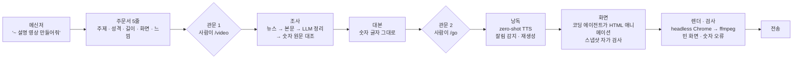
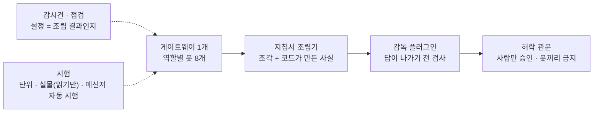

# 08 · 개인 프로젝트 — 메신저 한마디로 조사 → 대본 → 내 목소리 → 설명 영상을 만드는 멀티봇 에이전트

> 개인 프로젝트입니다(회사 업무·데이터와 무관). 텔레그램·디스코드에서 "~ 설명 영상 만들어줘" 한마디를 받으면
> **조사 → 대본 → 내 목소리 나레이션 → 모션그래픽 화면 → 렌더 → 전송**까지 무인으로 돌아가는 파이프라인을
> 2026-08부터 혼자 설계·운영하고 있습니다(로컬 git 611커밋, 영상 런 123회, pytest 93파일 시점 기준).
>
> 이 폴더는 그중 **"LLM이 틀리는 자리를 코드가 막는" 세 가지 장치**만 발췌했습니다. 봇 설정·토큰·개인 음성 데이터·대화 기록은 포함하지 않습니다.

## 문제 설정

LLM 에이전트가 영상 한 편을 만드는 데 20~25분과 구독 사용량이 듭니다. 그래서 **틀린 결과물이 가장 비쌉니다.** 실제로 겪은 사고 세 가지가 설계의 출발점입니다.

| 사고 | 원인 | 장치 |
|---|---|---|
| 봇은 주제를 제대로 알아들었는데, 자유 문장을 정규식으로 다시 파싱한 코드가 "에 대한 것들"을 주제로 잡아 엉뚱한 영상이 나감 | 모델의 이해 결과를 버리고 코드가 다시 추측 | **A. 주문서 관문** — 봇이 정해진 5줄을 쓰고, 코드는 그 줄만 읽는다. 닫힌 어휘, 허사만 남은 주제는 거절 |
| 자료의 0.12%가 대본에서 "영 점 일이칠 퍼센트", 화면에서 0.17%가 됨. 자료 한 줄의 13.02%는 원문에 없었음 | "지어내지 마라"는 프롬프트로는 안 잡힘 | **B. 숫자 대조** — 자료↔원문, 대본↔자료, 화면↔문장의 숫자를 글자 단위로 코드가 맞대 본다 |
| 1분짜리 대본이 30초대 음성으로 나왔는데 아무도 몰랐음(마지막 세 문장 누락, 단어 74%만 존재) | zero-shot TTS가 문장 끝을 확률적으로 일찍 끊음(약 60%) | **C. TTS 잘림 방어** — 희생 단어를 붙여 생성 후 잘라내고, 말한 길이와 받아쓰기로 판정, 시드를 바꿔 재생성 |

공통 원칙: **찾고 고르는 것은 모델, 맞는지 확인하는 것은 코드.** 결정은 모델이 하고 코드는 감독한다.

## 데이터 (종류만)

- 입력: 메신저 대화, 공개 웹 자료(뉴스·기사 본문·위키), 사용자가 준 파일(pdf·doc·표)
- 음성: 본인 녹음 약 26초(zero-shot 참조용, 모델 학습 없음)
- 산출: 대본 · wav + 문장 타이밍 json · mp4 · 스냅샷 · 실행 비용 기록

## 분석 프로세스

## 방법

### A. 주문서 관문 (`order_sheet.py`)

- 봇이 대화를 읽고 **정해진 줄 이름** 5개만 쓴다. 코드는 그 줄을 읽을 뿐 자유 문장을 해석하지 않는다.
- 줄은 닫힌 집합으로 검증한다: 길이는 5~300초로 클램프("1분"이 1초가 되지 않게), 화면비·느낌은 사전에 있는 낱말만, 모르는 느낌은 기본값(싼 실수), 모르는 화면비도 기본값이지만 **낱말이 낱말로 서 있는지** 정규식으로 본다("쇼트트랙"의 "쇼트"가 쇼츠로 잡혀 24분짜리가 세로로 나간 뒤).
- **주제가 허사·지시어뿐이면 거절**한다(`junk_topic`). 성격·길이·목소리는 비어도 통과시키고 "짐작했다"고 기록한다 — 흔한 누락 하나로 제대로 알아들은 주제까지 버리지 않기 위해.
- 작은 모델에게 주문서를 쓰게 하는 프롬프트는 "마지막 말이 무슨 부류인가"가 아니라 "**어떤 영상 이야기였고, 이미 시작됐는가**"를 묻도록 바꿨다. 문장 분류로는 "다 됐어?"와 "만들어줘"를 동시에 맞출 수 없었고, 상태를 물으니 둘 다 맞았다(한 문장 54/54 · 대화 14/14). 프롬프트에 예시 한 줄을 넣기 전에는 아무 줄이나 덧붙여도 결과가 뒤집혔다 — 운이 설계가 된 지점.

### B. 숫자 대조 (`number_check.py`)

- "센 숫자"만 본다: 소수점·쉼표·세 자리 이상, 또는 한두 자리 뒤에 %·조·억이 붙은 것. 날짜·시각과 작은 수(3개월·5거래일)는 보지 않는다.
- 한국식 적기를 아라비아 숫자로 편다(1천680 → 1680, 3만5천 → 35000, 27.6만 → 276000). 큰 덩이부터 바꿔 안쪽이 따로 풀리지 않게 한다.
- 같은 숫자로 치는 것: 쉼표, 끝의 0(29.8 = 29.80), 끊어 적은 정수(893 ← 893.22), 단위 표기 변형(13% = 13 percent). 다른 숫자: 0.12 ≠ 0.127, 13% ≠ 13.5%, 2.00 ≠ 2일.
- `script_check`는 대본의 센 숫자가 자료에 있는지 보고, 없으면 **한 자리만 다른 이웃 숫자**를 찾아 "자료의 7003.74와 비슷"처럼 알려 준다(어림수 7000은 7207의 오타로 보지 않는다).
- 음성에 넘기는 사본만 우리말 읽기로 바꾼다(`say`): 고유어 세는 말(세 개·스무 살), 범위(3~5%), 달러, 시각, 날짜 이름(6.25 전쟁은 소수가 아님). 못 읽는 꼴은 손대지 않는다 — 틀리게 읽느니 그대로.

### C. TTS 끝말 잘림 방어 (`tts_guard.py`)

- 문장 단위로 생성하고, 문장 끝에 **희생 단어**(" 네.")를 붙여 모델이 일찍 끊어도 진짜 마지막 음절이 중간에 놓이게 한다. 생성 후 마지막 침묵에서 잘라낸다.
- 잘라낼 자리는 **초 단위**로 판정한다(잘라낸 말소리 0.08~0.6초, 본문 0.3초 이상 남음). 비율(전체의 55% 뒤)로 보던 때는 짧은 문장에서 희생 단어가 그대로 남았다.
- 잘림 판정은 **말한 길이 vs 글자 수로 기대되는 길이**(이 기계에서 실측한 초당 글자 수의 78%)다. 끝 50ms 음량으로 보던 판정은 세 번 고쳐 세 번 틀렸다 — 깨끗하게 자른 끝도 마지막 음절이라 음량이 크다.
- 길이가 맞아도 다른 말일 수 있어(참조 녹음과 대본이 어긋난 프로필이 "보이책 보이책…"을 냈다) 로컬 Whisper로 **받아쓰기 비율**(≥0.60)을 본다. 영어 약자는 글자 이름으로 바꿔 비교한다.
- 실패하면 시드를 바꿔 최대 8회. 전부 실패해도 소리가 있고 길이가 맞는 것이 있으면 경고와 함께 쓰고 영상을 끝낸다 — 12번째 문장 하나 때문에 11문장(GPU 10~20분)을 버리지 않는다.

## 코드 발췌

| 파일 | 내용 |
|---|---|
| [`order_sheet.py`](order_sheet.py) | 주문서 읽기·검증: 닫힌 어휘 표, 낱말 경계 정규식, 허사 주제 거절, 길이 클램프 |
| [`number_check.py`](number_check.py) | 센 숫자 추출, 한국식 적기 전개, 원문 존재 검사, 이웃 숫자 탐지, 대본 검사 |
| [`tts_guard.py`](tts_guard.py) | 희생 단어 자르기, 길이 기반 잘림 판정, 받아쓰기 비율, 재생성 루프 뼈대 |

## 검증과 한계

- 단위 시험은 샌드박스에서(봇 폴더·실제 작업 폴더를 건드리지 못함), 실물 시험은 읽기만, 메신저 자동 시험기는 실제 계정으로 영상 한 편을 끝까지. 바꾸기 전후로 두 기계를 점검하고 설정이 조립 결과와 같은지 본다.
- 한계: 숫자가 원문에 **있는지**까지만 본다 — 원문 자체가 틀린 것, 숫자를 엉뚱한 자리에 쓴 것(코스피 값을 코스닥에)은 사람이 관문 2에서 본다. 내 목소리는 소리 1초에 5~6초가 든다. 두뇌가 한 계정의 한도를 공유해 한도가 차면 봇 전부가 멈춘다.
- 시청자 평가 같은 정량 품질 지표는 없다. 산출물은 사고 기록과 재발 방지 설계다.
