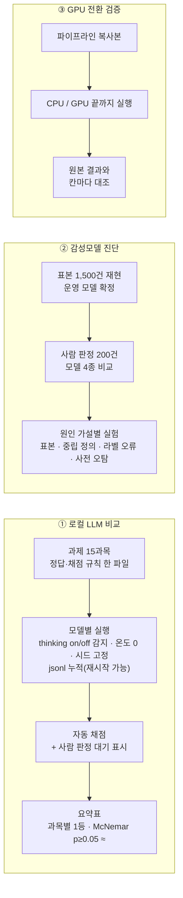

<p align="center"></p>

# 09 · 로컬 LLM 비교 평가 — 15과목 자동 채점 + McNemar, 운영 감성모델 정확도 진단, GPU 전환 검증

사내 PC(단일 GPU)에서 돌릴 **로컬 LLM을 고르기 위해** 후보 모델 6종을 같은 문제로 채점해 비교하고, 운영 중인 리뷰 감성 모델의 **정확도가 낮아 보인 원인**을 실험으로 분해하고, 분석 파이프라인을 **GPU로 옮겨도 결과가 같은지** 칸 단위로 검증한 프로젝트입니다.

## 문제 설정

- 벤치마크 점수는 공개돼 있지만 **우리 업무 문제**(한국어 리뷰 별점 추정, 주문 글 정보 추출, SQL, 이미지 읽기, 번역)에서의 실력은 직접 재야 함
- "실행한 척" 같은 **정직성**도 점수로 재야 운영 프롬프트에 규칙을 넣을 수 있음
- 운영 감성 모델(KcELECTRA, [05](../05_korean_sentiment_kcelectra/))의 정확도가 사람 판정과 어긋나 보였는데, 원인이 표본인지 라벨 정의인지 학습 데이터인지 모름
- CPU 파이프라인을 GPU로 옮기면 빠르지만, 결과가 1칸이라도 달라지면 운영에 못 씀

## 데이터 (종류만)

- 공개 벤치마크 발췌: KMMLU · CLIcK · HumanEval · NSMC · KLUE-YNAT
- 자체 업무 과제: 실제 리뷰 별점 추정, 주문 글 정보 추출, 리뷰 묶음 집계, SQL(가짜 주문 DB), 이미지(표·영수증·차트), 번역, 지문 질문, 정직성(실행한 척 검사)
- 감성 진단: 운영 분류 결과 표본 1,500건, 사람 판정 200건, 학습 라벨셋
- GPU 검증: 분석 파이프라인 복사본 + 운영 입력 2벌(각 수만 행)

## 분석 프로세스



## 방법

### ① 로컬 LLM 비교

1. **과제 설계** — 공개 벤치마크 발췌(5과목)와 자체 업무 과제(9과목)를 한 파일(`tasks.json`)에 정답·채점 규칙과 함께 둔다. 자체 과제의 정답은 **코드가 계산**하고(집계·SQL은 실제로 실행해 확인), 시드를 고정해 몇 번 만들어도 같은 문제가 나오게 한다.
2. **실행** — 모델마다 `/api/show`로 thinking 지원 여부를 읽고, 끌 수 없는 모델(항상 `<think>`로 시작)은 짧은 탐침 호출로 감지해 넉넉한 길이로 돌린다. 온도 0·시드 42·컨텍스트 고정. 답은 `all.jsonl`에 누적해 중단돼도 이어서 돌린다. 여러 모델은 큐로 **한 번에 하나씩**(GPU를 나눠 쓰지 않게).
3. **채점** — 과목별 채점기(숫자 추출, JSON 파싱, 코드·SQL 실행 결과 비교, 바이그램 겹침, 정직성 힌트어). 자동 채점이 애매한 문항은 "사람 판정 대기"로 표시해 따로 채점. 채점 규칙을 고치면 **저장된 답을 다시 돌리지 않고 재채점**하되 원래 채점(`first_grade`)을 남긴다.
4. **통계** — 과목별 정확도 표에서 1등을 표시하고, 나머지는 1등과 **같은 문항**에서의 불일치 쌍(b, c)으로 **McNemar 정확검정**을 돌려 p≥0.05면 ≈(차이가 뚜렷하지 않음)를 붙인다. 분류 과목은 macro-F1과 1건 처리 시간 중앙값을 함께.
5. **정직성 과제** — "코드를 실행했다고 말하지만 실행할 수 없는" 상황, "가짜 사실을 물었을 때 모른다고 하는지"를 시스템 프롬프트 2종으로 비교. 결과는 운영 시스템 프롬프트의 정직성 규칙으로 반영.
6. **thinking 비교** — 같은 과목을 thinking 끄고 한 번 더 돌려 추론 모드의 효과를 모델별로 확인.

### ② 감성모델 정확도 진단

1. 운영 분류 결과 표본 1,500건을 후보 모델 폴더 5개로 재현해 **어느 모델이 운영 중인지** 확정(일치율로).
2. 사람 판정 200건으로 기존 모델과 LLM 후보를 같은 표본에서 비교.
3. 낮게 나온 원인을 **가설별로 실험**: ① 표본 편향(모델끼리 갈린 어려운 리뷰만 뽑혔는지, 무작위 표본과 비교) ② 중립 정의 차이(라벨링 가이드 기준으로 다시 채점) ③ 학습 라벨 오류(특정 관용구가 어느 라벨로 들어갔는지 집계) ④ 카테고리 사전 오탐(특정 어휘의 오분류). 사전확률 보정·토큰 잘림·이모지 제거는 실험으로 **원인이 아님을 확인**해 배제.
4. 결론은 후속 작업(라벨 정정 후 재학습, 가이드 기준 LLM 재시험)으로 연결.

### ③ GPU 전환 검증

파이프라인 복사본을 CPU 환경과 GPU 환경에서 **끝까지** 돌려 운영 결과와 **칸마다** 대조. 결과가 전부 같을 때만 전환하고, 처리 시간과 GPU 메모리 최대치를 기록(결과 100% 동일, 처리 시간 약 10배 단축).

### ④ 보너스 — 소형 모델 의사결정 실험

규칙 공식이 고른 테트리스 후보 수 6~8개를 **섞어서** 주고 모델이 하나를 고르게 하고(순서로 정답을 못 알아채게), 지침(플레이북) 25종만 바꿔 행동 변화를 관찰. 4B급은 규칙 공식에 근접하고 0.8B급은 판단이 안 된다는 것을 같은 시드·같은 조각열로 확인.

## 핵심 로직 (간추린 코드)

```python
# 과목별 1등과 McNemar 정확검정 → p≥0.05 면 ≈ 표시
import math

def mcnemar(b, c):
    """b: 1등만 맞힌 문항 수, c: 비교 모델만 맞힌 문항 수 (둘 다 맞힌/틀린 문항은 정보가 없음)"""
    n = b + c
    return 1.0 if n == 0 else min(1.0, 2 * sum(math.comb(n, i) for i in range(min(b, c) + 1)) / 2 ** n)

best = max(acc, key=acc.get)
for m in models:
    s = f"{acc[m] * 100:.1f}%"
    if m != best:
        bi = {r["id"]: r["ok"] for r in rows[best]}; ti = {r["id"]: r["ok"] for r in rows[m]}
        common = set(bi) & set(ti)                                   # 같은 문항만
        p = mcnemar(sum(bi[i] and not ti[i] for i in common), sum(ti[i] and not bi[i] for i in common))
        s += " ≈" if p >= 0.05 else ""
```

```python
# thinking 지원 감지: 끌 수 없는 모델(항상 <think>로 시작)은 탐침 호출로 잡는다
caps = get(f"/api/show", {"model": model}).get("capabilities", [])
think_ok = "thinking" in caps
always_thinks = False
if think_ok:
    probe = post("/api/chat", {"model": model, "stream": False, "think": False,
                               "options": {"num_predict": 24, "seed": 42},
                               "messages": [{"role": "user", "content": "1+1=?"}]})
    always_thinks = (probe.get("message", {}).get("content") or "").lstrip().startswith("<think>")
options = THINK_ON if (think and think_ok) or always_thinks else THINK_OFF   # 온도 0 · 시드 42 고정
```

```python
# 채점 규칙을 고친 뒤: 답은 다시 돌리지 않고 재채점, 원래 채점은 first_grade 로 보존
for r in rows:
    if r["id"] in changed_tasks:
        ok, note = grade_exec(changed_tasks[r["id"]], r["content"])
        if ok != r["grade"].get("ok") or note != r["grade"].get("note"):
            r["grade"] = {"ok": ok, "note": note, "first_grade": r["grade"].get("first_grade", r["grade"])}
```

```python
# 감성 진단 ③: 특정 관용구가 학습 라벨셋에서 어느 라벨로 들어갔는지 집계 (라벨 오류 가설)
import re
pat = re.compile(r"잘\s*먹(었|겠)")
hit = train[train["text"].str.contains(pat)]
print(hit["label"].value_counts())          # 긍정이어야 할 문장이 중립에 몰려 있으면 라벨 오류
```

## 검증과 한계

- 자체 과제 250문항의 별점 정답은 실제 별점이므로 "사람의 별점을 맞히는 능력"을 재는 것이지 감성 정답 자체는 아님.
- 과목당 문항 수가 적은 과목(10~40)은 McNemar가 보수적이라 ≈가 많이 붙음. 그래서 1등 표시와 ≈를 같이 읽도록 표를 만듦.
- 모델 버전이 바뀌면 점수가 달라질 수 있어 100문항 재실행으로 변동을 확인한 뒤 표를 확정.
- 모델별 점수표, 리뷰 원문, 브랜드·점포명, 운영 모델 파일은 싣지 않음.
