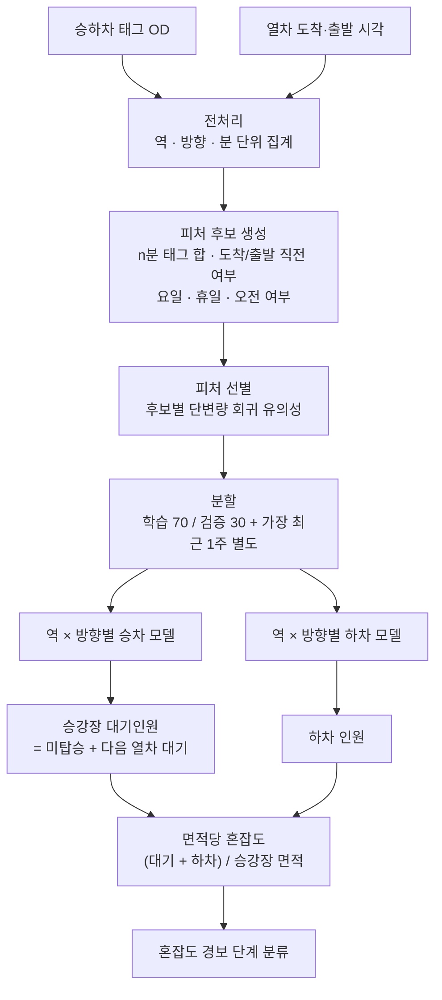

<p align="center"></p>

# 11 · 승강장 혼잡도 예측 — 교통카드 태그 시계열 피처 · 역×방향 회귀 · 면적당 경보 단계

공공기관 의뢰 정책 분석 과제(2023)입니다. 수도권 경전철 노선의 **승강장 안 대기·하차 인원을 미리 예측**해 면적당 혼잡도를 계산하고, 혼잡 **경보 단계**를 내는 모델을 만들어 납품했습니다. 분석 설계를 뺀 전 과정(전처리 → 피처 → 역별 모델 → 혼잡도 산출 → 경보 분류)을 맡았습니다.

## 문제 설정

- 목표: 출퇴근 시간대 승강장 과밀로 인한 **안전사고 예방**. 혼잡을 "지금"이 아니라 **몇 분 앞서** 알아야 함
- 승강장에 있는 사람 = **직전 열차를 못 탄 사람 + 다음 열차를 기다리는 사람 + 막 내린 사람**. 카드 태그는 개찰구에서만 찍히므로 승강장 인원은 직접 관측되지 않음
- 역마다 요일·시간대 이용 패턴이 다르고, 같은 역도 **상선·하선**이 다름

## 데이터 (종류만)

| 출처 | 내용 |
|---|---|
| 교통카드 승하차 태그 | 역·개찰구·시각 단위 승차/하차 태그 (OD) |
| 열차 운행 기록 | 역별 도착·출발 시각 |
| 역 시설 정보 | 승강장 면적 |
| 달력 | 요일·공휴일 |

## 분석 프로세스



## 방법

1. **분 단위 시계열로 재구성** — 태그를 역·방향·분 단위로 집계하고 열차 도착·출발 시각을 붙인다. "열차가 오기 1분 전인가"가 대기 인원을 크게 바꾸므로 운행 기록과의 시각 정합이 핵심.
2. **피처 후보를 넓게 만들고 근거로 줄이기** — n분 동안의 승차·하차 태그 합(여러 n), 열차 도착·출발 1분 전 여부, 요일·휴일·오전 여부 등 **후보를 150여 개** 만든 뒤, 후보마다 단변량 회귀로 유의성을 확인해 **120여 개**만 남겼다. 처음부터 "그럴듯한" 몇 개만 쓰지 않고 넓게 만들어 근거로 줄였다.
3. **역 × 방향마다 따로 모델** — 노선 전체 하나의 모델 대신, 역과 상·하선 조합마다 승차·하차 회귀 모델을 따로 맞췄다. 역마다 이용 패턴이 달라, 하나로 묶으면 이용객이 많은 역의 패턴이 나머지를 덮기 때문.
4. **최근 1주를 별도 검증 구간으로** — 무작위 70/30 분할만 쓰면 시간 순서가 섞여 낙관적으로 나온다. **가장 최근 1주**를 따로 떼어 "앞으로의 날"에 대한 성능을 함께 봤다.
5. **관측되지 않는 양을 식으로 연결** — 승강장 대기인원은 직접 관측이 안 되므로 "직전 열차 미탑승 + 다음 열차 탑승 대기"로 정의하고 예측 승차 인원에서 계산. 여기에 예측 하차 인원을 더해 **승강장 면적으로 나눈 값**을 혼잡도로 쓰고, 구간을 나눠 경보 단계로 분류.

## 코드 — 구조 예시 (재구성)

> 원본 코드(노트북)는 의뢰 과제 산출물이라 공개하지 않습니다. 아래는 **방법의 구조를 보여 주기 위해 다시 쓴 예시**이며, 변수 이름·구간 값은 설명용입니다.

```python
import pandas as pd
import statsmodels.formula.api as smf

def build_features(tags: pd.DataFrame, trains: pd.DataFrame, windows=(1, 3, 5, 10)):
    """tags: 역·방향·분 단위 승차/하차 태그 수, trains: 역·방향별 도착/출발 시각."""
    g = tags.sort_values("ts").groupby(["station", "direction"])
    for n in windows:                                    # n분 태그 합 (과거만 사용)
        tags[f"board_{n}m"] = g["board"].transform(lambda s: s.shift(1).rolling(n, min_periods=1).sum())
        tags[f"alight_{n}m"] = g["alight"].transform(lambda s: s.shift(1).rolling(n, min_periods=1).sum())
    arr = trains.set_index(["station", "direction", "arrive_ts"]).index
    tags["pre_arrival_1m"] = tags.set_index(["station", "direction", "ts"]).index.isin(
        arr.set_levels(arr.levels[2] - pd.Timedelta(minutes=1), level=2)).astype(int)
    tags["holiday"] = tags["ts"].dt.date.isin(HOLIDAYS).astype(int)
    tags["morning"] = (tags["ts"].dt.hour < 12).astype(int)
    return tags

def select_features(df, target, candidates, alpha=0.05):
    """후보마다 단변량 회귀 → 유의한 것만 남긴다."""
    keep = []
    for c in candidates:
        fit = smf.ols(f"{target} ~ {c}", data=df).fit()
        if fit.pvalues[c] < alpha:
            keep.append(c)
    return keep

def fit_per_station(df, target, feats):
    """역 × 방향마다 따로 맞춘다. 가장 최근 1주는 검증용으로 남긴다."""
    models, last_week = {}, df["ts"].max() - pd.Timedelta(days=7)
    for key, part in df.groupby(["station", "direction"]):
        train = part[part["ts"] < last_week].sample(frac=0.7, random_state=0)
        models[key] = smf.ols(f"{target} ~ " + " + ".join(feats), data=train).fit()
    return models

def crowding_level(waiting, alighting, area_m2, cuts=(1.0, 2.0, 3.0)):
    """면적당 인원 → 경보 단계 (구간 값은 예시)."""
    density = (waiting + alighting) / area_m2
    return sum(density >= c for c in cuts)      # 0=여유 1=보통 2=주의 3=혼잡
```

## 검증과 한계

- 검증은 무작위 30% 홀드아웃과 **가장 최근 1주**를 함께 봤고, 역·방향마다 정확도를 따로 보고했다. 역에 따라 정확도 편차가 있었고, 이용 패턴이 뚜렷한 **출근 시간대**가 상대적으로 잘 맞았다.
- 승강장 대기인원은 관측값이 없어 **정의식으로 계산한 값**이다. 실제 승강장 인원과의 차이는 이 검증 범위 밖이다.
- 선형 회귀라 학습 기간에 드문 상황(행사·운행 지연 등)은 반영되지 않는다.
- 의뢰기관·노선명·역명·정확도 실측치는 싣지 않는다.
