

<b>예측 · 공간통계 · 텍스트마이닝 · Gen-AI 에이전트</b>를 실무에 적용해 온 응용 데이터 사이언티스트의 <b>방법론 포트폴리오</b>입니다. 
공공기관 분석 PL로 정책 데이터 과제를 수행했고, 이후 외식 프랜차이즈 본사에서 <b>수집 → 데이터마트 → 모델링 → 검증 → 풀스택 BI 배포</b>까지 혼자 구축했습니다.

> **TL;DR (EN)** — Applied data scientist (7 yrs: public-sector analytics PL → F&B franchise HQ). This repo shows *how* I decide: 11 anonymized case studies (problem → data → process → method → code → validation & limits) plus runnable demos on synthetic data. Company data, brand names and real metrics are intentionally excluded.

> 회사 데이터·브랜드명·점포명·실측 수치·접속 정보는 포함하지 않습니다. 각 폴더는 **문제 설정 → 데이터(종류만) → 프로세스 도식 → 방법 → 코드 → 검증과 한계** 순서로 같고, 화면 캡처는 브랜드명·수치를 가린 것입니다.

## 프로젝트

<table>
<tr>
<td width="50%"><a href="01_sales_forecasting/"></a></td>
<td width="50%"><a href="02_spatial_esda/"></a></td>
</tr>
<tr>
<td><a href="03_store_clustering_anomaly/"></a></td>
<td><a href="04_effect_testing_fdr/"></a></td>
</tr>
<tr>
<td><a href="05_korean_sentiment_kcelectra/"></a></td>
<td><a href="06_genai_tool_agent/"></a></td>
</tr>
<tr>
<td><a href="07_rule_based_scoring/"></a></td>
<td><a href="08_personal_agent_video_pipeline/"></a></td>
</tr>
<tr>
<td><a href="09_local_llm_eval_sentiment_diag/"></a></td>
<td><a href="10_ai_judging_multiagent_site/"></a></td>
</tr>
<tr>
<td><a href="11_platform_crowding_regression/"></a></td>
<td></td>
</tr>
</table>

## 한눈에 보기 — 무엇을 왜 그렇게 했나

| # | 프로젝트 | 핵심 판단 | 기법 |
|---|---|---|---|
| 01 | [매출 예측](01_sales_forecasting/) | 튜닝 지표(MSE)와 선택 지표(MAPE)를 나누고, 특일을 뺀 MAPE를 "평소 정확도"로 따로 봄 | 트리 5종 후보선택 · Prophet · 볼록가중 블렌딩 · SHAP |
| 02 | [공간통계 ESDA](02_spatial_esda/) | 인접(Queen) 대신 KNN 가중치로 이웃 없는 구역을 없애고, 매출 예측이 아닌 **스크리닝**으로 범위를 한정 | Moran's I · LISA · KDE · 공간 블록 CV |
| 03 | [점포 등급화·이상탐지](03_store_clustering_anomaly/) | 전체 평균 밴드는 주말을 전부 이상으로 잡으므로 **요일조건부** 밴드 | Ward HAC 최적 K · Jenks · ±1.5σ |
| 04 | [효과 검증](04_effect_testing_fdr/) | 배정이 무작위가 아니라 **인과 대신 연관성**으로 한정, 항목 수십 개는 BH-FDR로 보정 | ANOVA/Tukey · 비모수 검정 · BH-FDR |
| 05 | [리뷰 감성](05_korean_sentiment_kcelectra/) | GPU 없는 서버라 트랜스포머는 **룰이 애매한 리뷰에만** | 룰 + KcELECTRA · ONNX · Mann-Kendall |
| 06 | [tool-calling 에이전트](06_genai_tool_agent/) | 도구 권한은 모델이 아니라 **코드가** 정함, 키 없이 도는 테스트 | @tool 스키마 · 가드레일 6종 · 오프라인 TDD |
| 07 | [규칙 기반 스코어링](07_rule_based_scoring/) | 임베딩보다 **"모른다"를 말할 수 있는** 규칙 매칭을 선택 | 복합점수 · 배타 규칙 · 다단계 매칭 |
| 08 | [멀티봇 영상 파이프라인](08_personal_agent_video_pipeline/) (개인) | 작은 모델의 자유 문장을 해석하지 않고 **정해진 줄만** 읽는 주문서 관문 | 주문서 관문 · 숫자 대조 · TTS 잘림 방어 |
| 09 | [로컬 LLM 평가·감성모델 진단](09_local_llm_eval_sentiment_diag/) | 벤치마크 대신 **업무 과제**로 재고, GPU 결과가 한 칸이라도 다르면 전환하지 않음 | 15과목 자동 채점 · McNemar · 원인 가설 실험 |
| 10 | [멀티에이전트 AI 심사](10_ai_judging_multiagent_site/) | 플레이하지 않고 추측한 점수는 무효, 조작 문구 방어, **최종 판단은 사람** | 마더 + 서브에이전트 3단계 · 파일 기반 검증 |
| 11 | [승강장 혼잡도 예측](11_platform_crowding_regression/) (공공) | 노선 전체 하나가 아니라 **역 × 방향마다** 모델, 가장 최근 1주를 별도 검증 | 태그 시계열 피처 · 회귀 · 면적당 경보 단계 |

01~07·09·10은 외식 프랜차이즈 본사 실무, 11은 공공기관 의뢰 과제, 08은 개인 프로젝트입니다.

## 실행해 보기 — [`demos/`](demos/)

폴더의 코드는 업무 코드 **발췌**라 그대로 돌릴 수 없어서, 같은 방법의 구조를 **가상 데이터로 다시 만든 예제**를 두었습니다. 테스트는 GitHub Actions에서 자동으로 돕니다.

- [`effect_testing_bh`](demos/effect_testing_bh/) — 진짜 효과 6개를 심은 가상 데이터에서 보정 없는 p<0.05 vs BH-FDR 비교 (04)
- [`forecast_blending`](demos/forecast_blending/) — 피처 누수 차단(`shift(1)`) 테스트, MAPE로 후보 선택, 볼록가중 블렌딩 (01)

## 글 — [`writing/`](writing/)

- [감성 모델이 사람 판정과 어긋날 때 — 원인 가설을 하나씩 지운 기록](writing/01_sentiment_model_diagnosis.md)
- [임베딩 대신 규칙을 고른 이유 — "모른다"를 말할 수 있는 매칭](writing/02_rules_that_say_i_dont_know.md)

## 코드 저장소

- [seoul-living-population-gis](https://github.com/Azmo-Shin/seoul-living-population-gis) — 02의 데이터 기반: 서울 250m 생활인구 적재·공간차원·집계마트·FastAPI·React/deck.gl
- [gemma4-agent-template](https://github.com/Azmo-Shin/gemma4-agent-template) — 06의 전체 템플릿 코드 (오프라인 테스트 CI)
- [meeting-minutes-cli](https://github.com/Azmo-Shin/meeting-minutes-cli) — 회의·강의 음성 → 화자분리 전사 → 로컬 LLM 회의록 CLI (개인)

## 주로 쓰는 도구

Python (pandas · scikit-learn · statsmodels · PyTorch) · SQL · Prophet/XGBoost/LightGBM · GeoPandas/libpysal/QGIS · KcELECTRA/ONNX · Ollama · FastAPI · React/Vue

## 공개 정책

- 회사명·브랜드명·점포명·담당자명·실제 매출·가격·모델 성능 실측치는 싣지 않습니다. 실측치는 이력서·면접에서 근거와 함께 설명합니다.
- DB 접속정보·API 키·서비스계정·사내 주소는 코드에서 제거했습니다.
- 폴더의 코드는 알고리즘 로직 발췌이고, 실행 가능한 재현은 `demos/`(가상 데이터)에 있습니다.
- 라이선스: 글·도식·그림 CC BY 4.0, 코드 MIT ([LICENSE](LICENSE)).

## Contact

- Email: 93hjshin@gmail.com
