
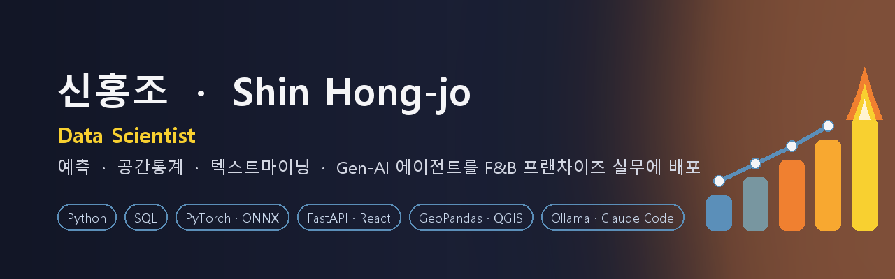

<b>예측 · 공간통계 · 텍스트마이닝 · Gen-AI 에이전트</b>를 F&B 프랜차이즈 실무에 적용해 온 응용 데이터 사이언티스트의 <b>방법론 포트폴리오</b>입니다. 
외식 프랜차이즈 본사에서 <b>수집 → 데이터마트 → 모델링 → 검증 → 풀스택 BI 배포</b>까지 혼자 구축했고, 그 전에는 공공기관 분석 PL로 정책 데이터 프로젝트를 수행했습니다.

> 회사 데이터·브랜드명·점포명·실측 수치·접속 정보는 포함하지 않습니다. 각 폴더는 **문제 설정 → 데이터(종류만) → 프로세스 도식 → 방법 → 코드 발췌 → 검증과 한계** 순서로 같고, 화면 캡처는 브랜드명·수치를 가린 것입니다.

## 프로젝트

<table>
<tr>
<td width="50%"><a href="01_sales_forecasting/">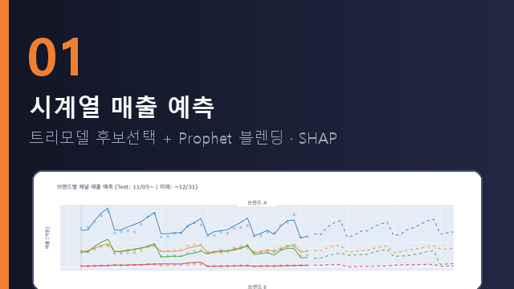</a></td>
<td width="50%"><a href="02_spatial_esda/">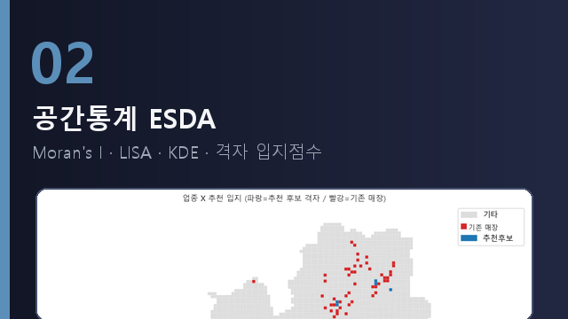</a></td>
</tr>
<tr>
<td><a href="03_store_clustering_anomaly/">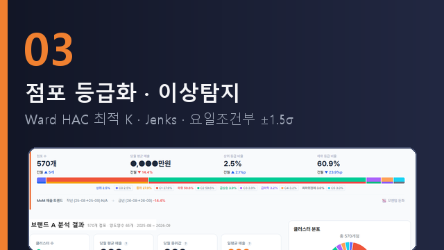</a></td>
<td><a href="04_effect_testing_fdr/">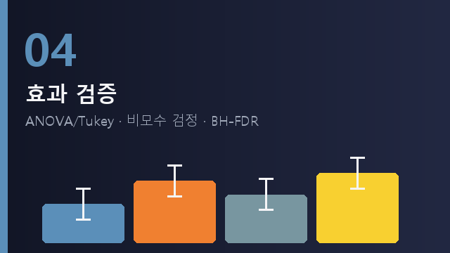</a></td>
</tr>
<tr>
<td><a href="05_korean_sentiment_kcelectra/">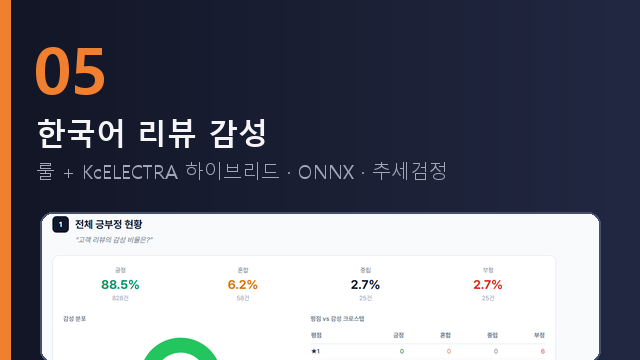</a></td>
<td><a href="06_genai_tool_agent/">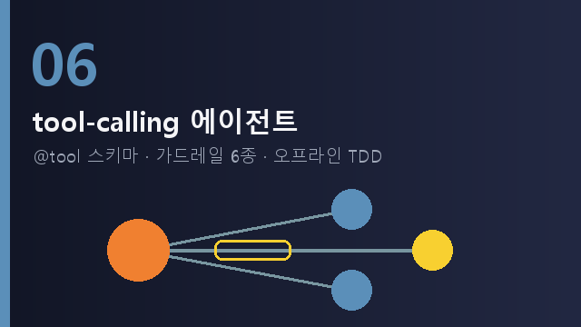</a></td>
</tr>
<tr>
<td><a href="07_rule_based_scoring/">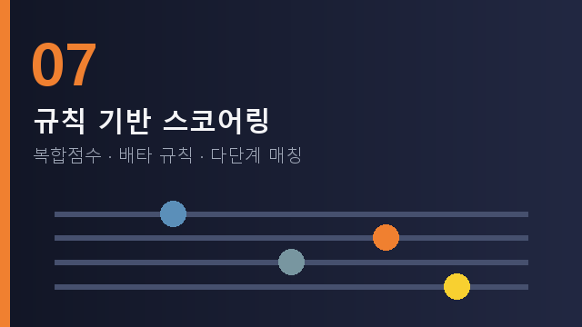</a></td>
<td><a href="08_personal_agent_video_pipeline/">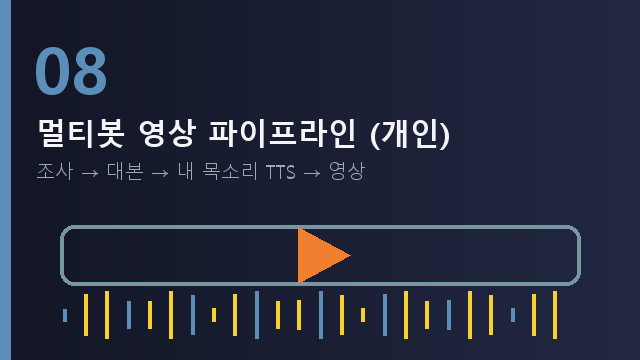</a></td>
</tr>
<tr>
<td><a href="09_local_llm_eval_sentiment_diag/">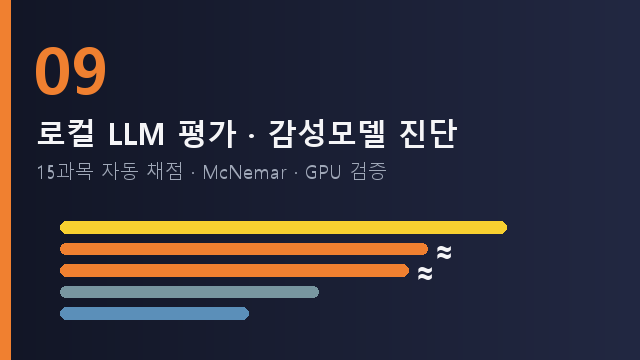</a></td>
<td><a href="10_ai_judging_multiagent_site/">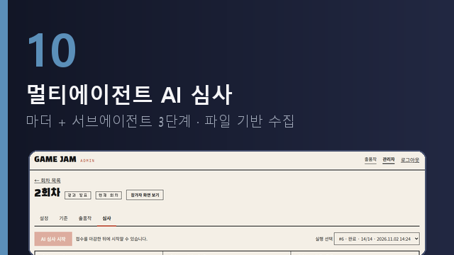</a></td>
</tr>
</table>

## 한눈에 보기

| # | 폴더 | 한 줄 요약 | 핵심 기법 |
|---|---|---|---|
| 01 | [`01_sales_forecasting`](01_sales_forecasting/) | 브랜드×채널 일매출 예측 + 프로모션 what-if | 트리모델 5종 TimeSeriesSplit 후보선택 · Prophet add_regressor · 볼록가중 블렌딩 · 특일 분해 MAPE · SHAP |
| 02 | [`02_spatial_esda`](02_spatial_esda/) | 업종 공간 패턴 판정 + 격자 입지점수 | Moran's I · LISA · KDE · 999회 순열 · K-민감도 · 편상관 · 로지스틱 + 공간 블록 CV |
| 03 | [`03_store_clustering_anomaly`](03_store_clustering_anomaly/) | 점포 월간 등급화 무인 배치 + 이상탐지 | Ward HAC gap-ratio 최적 K · IQR 분리 · 1D Jenks · 양도양수 병합 · 요일조건부 ±1.5σ |
| 04 | [`04_effect_testing_fdr`](04_effect_testing_fdr/) | 담당자·마케팅 효과 검증 | ANOVA/Tukey · Spearman · Mann-Whitney · Kruskal-Wallis · Benjamini-Hochberg FDR |
| 05 | [`05_korean_sentiment_kcelectra`](05_korean_sentiment_kcelectra/) | 리뷰 감성·토픽 분석 체계 | 룰+KcELECTRA 하이브리드 · StratifiedKFold · ONNX CPU 서빙 · LDA/BERTopic · Mann-Kendall |
| 06 | [`06_genai_tool_agent`](06_genai_tool_agent/) | 프레임워크 없는 tool-calling 에이전트 | @tool 스키마 · 가드레일 6종 · 오프라인 TDD · NL→SQL allowlist |
| 07 | [`07_rule_based_scoring`](07_rule_based_scoring/) | 키워드·노출순위·상담·매핑코드 규칙 점수 | 5요소 복합점수 · 배타 규칙 분류 · 다단계 문자열 매칭 · 홀드아웃 벤치마크 |
| 08 | [`08_personal_agent_video_pipeline`](08_personal_agent_video_pipeline/) | (개인) 메신저 한마디 → 조사·대본·내 목소리·영상 자동 생성 멀티봇 | 주문서 관문 · 숫자 글자 대조 · zero-shot TTS 잘림 방어 · 역할별 봇 8개 운영 · 사람만 승인 |
| 09 | [`09_local_llm_eval_sentiment_diag`](09_local_llm_eval_sentiment_diag/) | 로컬 LLM 6종 15과목 비교 + 운영 감성모델 진단 + GPU 전환 검증 | 자체 과제 자동 채점 · thinking 감지 · McNemar ≈ 표시 · 정직성 과제 · 원인 가설 실험 · 칸 단위 대조 |
| 10 | [`10_ai_judging_multiagent_site`](10_ai_judging_multiagent_site/) | 게임 해커톤 멀티에이전트 AI 심사 사이트 | 마더+서브에이전트 N개 동시 · 3단계(병렬 심사→취합 검토→최종 판정) · 파일 기반 수집·검증 · 조작 문구 방어 · 사람 최종 검토 |

01~07·09·10은 회사 실무, 08은 개인 프로젝트입니다.

## 기술 스택

| 분류 | 기술 |
|---|---|
| 언어·데이터 | Python (pandas · NumPy · scikit-learn · SciPy · statsmodels · PyTorch) · SQL (MySQL · MariaDB · PostgreSQL · BigQuery) · Git |
| 예측·검증 | Prophet · XGBoost · LightGBM · TimeSeriesSplit · RandomizedSearchCV · SHAP · 공적분/Granger · VIF |
| 통계 | ANOVA/Tukey · Spearman · Mann-Whitney · Kruskal-Wallis · BH-FDR · Mann-Kendall · McNemar · 순열검정 |
| 공간 | GeoPandas · libpysal · esda · QGIS · KDE |
| NLP·Gen-AI | KcELECTRA 파인튜닝 · ONNX · LDA · BERTopic · kiwipiepy · tool-calling 에이전트 · MCP · 로컬 LLM 평가(Ollama) · Claude Code 멀티에이전트 · 멀티봇 운영(Hermes) · zero-shot TTS(Qwen3-TTS) |
| 엔지니어링 | FastAPI · Vue3 · React · Dash · SQLAlchemy · SQLite · 월간 배치 · Selenium/Playwright |

## 공개 정책

- 회사명·브랜드명·점포명·담당자명·실제 매출·가격·모델 성능 실측치는 일절 싣지 않습니다.
- DB 접속정보·API 키·서비스계정·사내 주소는 코드에서 제거했습니다.
- 코드는 알고리즘 로직 발췌이며, 재현 예제가 필요하면 공개 데이터로 별도 구성합니다.

## Contact

- Email: 93hjshin@gmail.com
