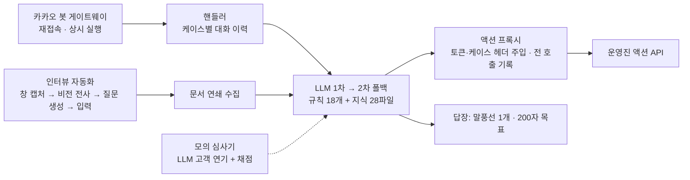

# AI_TOP_100 예선 회고 — 기술은 됐는데, 운영에서 졌다

> 2026-10-31 · 개인 참가 · 결과: 예선 탈락
> 대회 측 문제 자료·API 문서·토큰은 싣지 않습니다. 이 글은 **내가 만든 구조와 실패 원인 분석**만 다룹니다.

## 한 줄 요약

카카오톡 봇 위에서 도는 **고객상담(CS) LLM 에이전트**를 하루 만에 만들었고, 정상으로 처리된 턴은 기준을 잘 맞췄습니다(응답 p95 15.7초, 말풍선 1개, 평균 121자). 그런데 심사가 시작되고 **2분 40초 만에 1차 LLM의 월 지출 한도가 걸렸고, 2차 LLM도 이미 한도가 소진된 상태**였습니다. 30케이스 128턴 중 75턴이 실패했습니다. 기술이 아니라 **운영(LLM 한도 관리)** 에서 진 대회였습니다.

## 과제 — 당일 아침에야 알 수 있었던 것

카카오톡 봇 위에서 동작해야 한다는 것 말고는, 과제 내용이 당일 10시에 공개됐습니다.

- 가상 온라인 몰의 **고객상담 에이전트**를 만들 것
- 관계자 10명에게 카톡으로 **인터뷰**해서 규정·계약서·원장 같은 문서를 직접 모아야 함(문서가 다른 문서를 참조하면 그 이름으로 다시 요청)
- 조회·접수는 운영진이 준 **액션 API**로 처리(주문·배송·결제·회원·쿠폰·이관 등)
- 심사는 **LLM 시뮬레이터**가 30케이스를 15분 동안 병렬로 보냄. 평가는 인터뷰 지식 수, 응답 속도 p95, 말풍선 수, 글자 수, 정확도

사전에 예상한 과제(조합 업무 데이터 분석)와 내용이 전혀 달랐습니다. 그래도 **형식**(봇 게이트웨이, 상시 실행, 1초 배포, 장애 대응)을 미리 끝내 둔 덕분에, 문제 공개 25분 뒤에 첫 CS 버전을 배포할 수 있었습니다.

## 만든 것

설계에서 내린 판단은 다섯 가지입니다.

1. **토큰은 모델에게 주지 않는다** — 모델은 로컬 프록시만 부르고, 프록시가 인증 토큰과 케이스 헤더를 붙인다. 모든 호출이 기록에 남고, 심사 중 헤더 오류는 0건이었다.
2. **인터뷰는 사람 손을 빼고 자동화** — 카톡 창을 캡처해 비전 모델로 읽고, 다음 질문을 만들어 입력·전송한다. 받은 문서에 다른 문서 이름이 나오면 그걸 다음 질문 대상으로 삼아 **연쇄로** 모았다. 관계자 9명과 400여 턴, 문서 30종을 이렇게 수집했다.
3. **지식은 2단으로** — 요약은 프롬프트에 넣고 전문은 참조 폴더로 내렸다. 응답 시간이 21초에서 5~7초로 줄었다.
4. **심사 기준에 답 모양을 맞춘다** — 말풍선 1개, 200자 목표, 케이스가 바뀌면 이력 초기화.
5. **스스로 심사해 본다** — LLM에게 고객을 연기시키는 모의 심사기와, 서브에이전트 4개의 교차 감사로 놓친 사실을 찾아 규칙 18개로 정리했다.

## 결과

| | |
|---|---|
| 심사 | 30케이스 · 128턴 |
| 정상 턴 | 53턴 — 응답 중앙값 8.4초, p95 15.7초, 말풍선 1개, 평균 121자, 액션 API 110건 중 106건 성공 |
| 실패 턴 | 75턴 — 두 LLM 경로 모두 한도 소진, 17케이스는 전부 실패 |

## 왜 졌나 — 원인과 다음 조치

| 무엇이 | 왜 | 다음에 |
|---|---|---|
| 심사 중 두 LLM 모두 한도 | 오후에 돌린 인터뷰 루프·모의 심사·감사가 **봇과 같은 계정**의 한도를 써 버렸다. 심사 전 잔량을 확인하지 않았다 | 심사용 경로는 **전용 계정으로 분리하고 3중화**. 제출 전 잔량·지출 상한 점검을 체크리스트에 고정. 크레딧은 프롬프트 길이 × 예상 턴 × 2배로 계산 |
| 타임아웃 18턴 | 동시 3~4케이스 × 긴 프롬프트 × 턴당 API 호출이 많았다 | 턴당 API 호출 상한, 조회 결과 캐시, **4케이스 병렬** 리허설 |
| 타임아웃 뒤에도 접수가 실행됨 | 시간이 다 돼도 하위 프로세스를 멈추지 않았다 | 타임아웃 즉시 프로세스 종료, 접수성 호출은 턴당 1회로 중복 차단 |
| 일부 API 요청 형식 오류 | 리허설에서 접수 API를 전부 실행해 보지 않았다 | 모든 POST를 사전에 한 번씩 실행해 성공한 요청 예시를 지식에 넣기 |
| 사진 첨부를 못 봄 | 이미지 URL 처리가 없었다 | URL 감지 → 다운로드 → 비전 전사 |

## 배운 점

- **형식은 미리, 내용은 당일 1시간 안에 바꿀 수 있는 틀로.** 과제가 바뀌어도 프롬프트와 지식 폴더만 갈아 끼우면 되는 구조가 살렸다.
- **모델 성능보다 먼저 "모델을 쓸 수 있는가"를 지켜야 한다.** 에이전트를 운영할 때는 한도·지출 상한·폴백 경로도 기능의 일부다.
- 개발용 작업과 서비스 경로가 **같은 자원을 나눠 쓰지 않게** 분리한다. 데이터 파이프라인에서 운영 DB와 분석 쿼리를 나누는 것과 같은 원칙이었다.
